<!-- titlepage -->

# AI CAREER COMPANION: AN INTELLIGENT CAREER RECOMMENDATION AND SKILL-GAP ANALYSIS PLATFORM {.title}

A project report submitted in partial fulfilment of the requirements for the award of the degree of {.center}

**[DEGREE NAME, e.g. BACHELOR OF TECHNOLOGY]** {.center}

in {.center}

**[DEPARTMENT]** {.center}

Submitted by {.center}

**Jeswin Jarald** {.center}

[REGISTER NUMBER] {.center}

Internship organisation: Infosys (internship project) {.center}

Internship supervisor: [INTERNSHIP SUPERVISOR NAME] {.center}

Project guide: [PROJECT GUIDE NAME] {.center}

**[COLLEGE / UNIVERSITY NAME]** {.center}

[COLLEGE / UNIVERSITY ADDRESS] {.center}

[ACADEMIC YEAR] {.center}

<!-- frontmatter -->

## CERTIFICATE {.prelim}

> **Template — to be issued and signed by the institution. This page is not a certificate until it is completed and signed by the authorised signatories.**

This is to certify that the project report entitled **"AI Career Companion: An Intelligent Career Recommendation and Skill-Gap Analysis Platform"** is a record of the work carried out by **Jeswin Jarald** ([REGISTER NUMBER]) in partial fulfilment of the requirements for the award of the degree of [DEGREE NAME] in [DEPARTMENT] of [COLLEGE / UNIVERSITY NAME], during the academic year [ACADEMIC YEAR], under my supervision.

<!-- signatures: [PROJECT GUIDE NAME] | Project Guide | [HEAD OF DEPARTMENT NAME] | Head of the Department -->

Submitted for the project viva-voce examination held on [VIVA DATE].

<!-- signatures: Internal Examiner | | External Examiner | -->

<!-- pagebreak -->

## DECLARATION {.prelim}

> **Editable draft — the student must read, verify and amend this declaration before signing it.**

I, **Jeswin Jarald** ([REGISTER NUMBER]), hereby declare that the project report entitled **"AI Career Companion: An Intelligent Career Recommendation and Skill-Gap Analysis Platform"**, submitted to [COLLEGE / UNIVERSITY NAME] in partial fulfilment of the requirements for the award of the degree of [DEGREE NAME] in [DEPARTMENT], is a record of original work carried out by me as an Infosys internship project under the guidance of [PROJECT GUIDE NAME] and the supervision of [INTERNSHIP SUPERVISOR NAME].

I further declare that this report has not been submitted, in full or in part, to any other university or institution for the award of any degree or diploma, and that all sources of information used in it have been acknowledged.

Place: [PLACE]

Date: [SUBMISSION DATE]

<!-- signatures: Jeswin Jarald | Signature of the student -->

<!-- pagebreak -->

## ACKNOWLEDGEMENT {.prelim}

> **Editable draft — replace the placeholders and adjust the wording before submission.**

I express my sincere gratitude to [COLLEGE / UNIVERSITY NAME] and to the [DEPARTMENT] for the opportunity to undertake this project as part of my programme of study.

I thank Infosys for the internship opportunity within which AI Career Companion was designed, built and evaluated, and [INTERNSHIP SUPERVISOR NAME] for supervising the internship work.

I am grateful to my project guide, [PROJECT GUIDE NAME], for guidance throughout the project, and to [HEAD OF DEPARTMENT NAME], Head of the Department, for support and encouragement.

I also acknowledge the authors and maintainers of the open-source software on which this project depends, including FastAPI, SQLAlchemy, React, Sentence-Transformers and FAISS.

Finally, I thank my family and friends for their constant support.

**Jeswin Jarald**

<!-- pagebreak -->

## ABSTRACT {.prelim}

Students and early-career job seekers often struggle to judge which openings genuinely fit their current skills, which requirements they are missing for a particular role, and how to present their real experience without overstating it. General-purpose generative assistants can help with wording, but their output is not tied to the candidate's resume or to a fixed set of opportunities and can introduce qualifications the candidate does not have.

This report describes **AI Career Companion**, a web application developed as an Infosys internship project that turns a student's resume into grounded, explainable career guidance. A deterministic pipeline parses an uploaded PDF or DOCX resume into a structured candidate context. The context drives semantic retrieval over a curated knowledge base of 320 early-career opportunities in 15 technology domains, using `all-MiniLM-L6-v2` sentence embeddings (384 dimensions) and an exact FAISS index over 960 posting chunks, and a transparent, weighted, deterministic function ranks the results. The system adds evidence-based skill-gap analysis, a tailored resume summary and cover letter checked by a grounding validator, interview preparation, a conversational assistant that reuses these services, and an application tracker. All workflows run without a language model; a configured OpenAI-compatible model may only rewrite already-grounded text, under validation and with a deterministic fallback.

In an offline evaluation on 26 labelled retrieval queries, the final configuration achieved Hit@1 = 1.000, MRR@10 = 1.000, Precision@5 = 0.662, Recall@5 = 0.883 and nDCG@5 = 0.969; grounding checks found 0 violations, 10 of 10 injected faults were detected, 15 of 16 scripted conversation turns and 3 of 3 discovery probes behaved as intended. The backend test suite passed with 464 tests (and 1 expected failure) at the Milestone 4.4 release audit and with 555 tests on the current checkout. These results describe small, synthetic fixtures, not real-world effectiveness. Limitations include deterministic handling of general career questions, matching margins below target, a heuristic confidence flag, no live-LLM evaluation and an unimplemented learning roadmap.

**Keywords:** career recommendation, resume parsing, semantic search, sentence embeddings, FAISS, skill-gap analysis, grounded generation, FastAPI, React.

<!-- pagebreak -->

## TABLE OF CONTENTS {.prelim}

<!-- toc -->

<!-- pagebreak -->

## LIST OF FIGURES {.prelim}

<!-- lof -->

<!-- pagebreak -->

## LIST OF TABLES {.prelim}

<!-- lot -->

<!-- pagebreak -->

## LIST OF ABBREVIATIONS {.prelim}


| Abbreviation | Expansion |
|---|---|
| API | Application Programming Interface |
| CORS | Cross-Origin Resource Sharing |
| CRUD | Create, Read, Update, Delete |
| CSRF | Cross-Site Request Forgery |
| CSV | Comma-Separated Values |
| DFD | Data-Flow Diagram |
| DOCX | Office Open XML word-processing document |
| ERD | Entity-Relationship Diagram |
| FAISS | Facebook AI Similarity Search (library) |
| HTTP(S) | Hypertext Transfer Protocol (Secure) |
| JSON | JavaScript Object Notation |
| LLM | Large Language Model |
| MiB | Mebibyte (1,048,576 bytes) |
| MRR | Mean Reciprocal Rank |
| nDCG | Normalised Discounted Cumulative Gain |
| OCR | Optical Character Recognition |
| ORM | Object-Relational Mapper |
| PDF | Portable Document Format |
| RAG | Retrieval-Augmented Generation |
| REST | Representational State Transfer |
| SHA | Secure Hash Algorithm |
| SPA | Single-Page Application |
| SQL | Structured Query Language |
| UI / UX | User Interface / User Experience |
| UTC | Coordinated Universal Time |

<!-- mainmatter -->

# Introduction

## Background and Motivation

The transition from education to employment requires a student to make a series of linked decisions: which opportunities to pursue, how well their present skills match each one, what to learn next, how to tailor a resume and cover letter, how to prepare for interviews and how to keep track of applications. Each decision depends on the same underlying information — the student's actual skills, education, projects and experience, and the stated requirements of each opportunity — yet these steps are commonly carried out separately and by hand.

Generative AI assistants have made it easy to produce fluent career documents. Their output, however, is not inherently tied to the candidate's evidence. A system that writes "five years of experience leading a team" for a student who has neither is worse than unhelpful, because the student may submit the fabricated claim. This project was motivated by the view that career guidance software should be **grounded**: every recommendation, score and generated sentence should be traceable to something the student actually wrote, or to a requirement the opportunity actually states.

## Challenges Faced by Students and Job Seekers

In the general context of early-career job searching, students frequently:

- do not know which openings genuinely fit their current skills, and rely on keyword searches that miss relevant roles described in different words;
- cannot see precisely which requirements of a specific role they are missing, or whether a missing item is a hard requirement or a preferred one;
- write one generic resume and cover letter for every application, or, when using generative tools, risk including skills and experience they do not possess;
- prepare for interviews without connecting likely questions to their own projects and to their gaps for the role;
- lose track of where they applied, which deadlines apply and when interviews are scheduled.

These statements describe the problem context that motivated the project. They are not findings of this project: no user study was conducted, and this report makes no claim about how common these difficulties are in any particular population.

## Need for Resume-Based Recommendation and Skill-Gap Analysis

A resume is the most complete structured description of a candidate that a student already has. If it is parsed reliably, it can serve as a single source of truth for every later step: retrieving opportunities that are semantically related to the candidate's background, scoring fit transparently, listing each requirement as met, partially met or missing with quoted evidence, and constraining generated text to claims the resume supports. Skill-gap analysis is the bridge between recommendation and action: it converts "this role is a 52% match" into "these two required skills are missing, and this related skill gives partial support for a preferred one".

## Problem Statement

To design, implement and evaluate a web application that accepts a student's resume and career profile and, using only verifiable evidence, (i) retrieves relevant early-career opportunities from a curated knowledge base, (ii) ranks them with an explainable, deterministic score, (iii) analyses the student's gaps against a chosen opportunity, (iv) generates tailored application materials and interview preparation that never claim unsupported qualifications, (v) answers follow-up questions conversationally by reusing these services, and (vi) tracks the student's applications — while keeping each user's data private to that user, and while remaining fully functional without a large language model.

## Objectives

1. Extract structured, inspectable candidate context from PDF and DOCX resumes without OCR and without requiring an LLM.
2. Retrieve relevant opportunities semantically from a curated, validated knowledge base.
3. Score candidate–opportunity fit with transparent, deterministic, weighted logic and plain-language explanations.
4. Make every generated statement traceable to candidate evidence and never claim a skill the candidate has not shown.
5. Keep an optional LLM strictly subordinate: grounded input, validated JSON output and a deterministic fallback.
6. Persist each user's data under strict ownership and prevent cross-user access.
7. Measure the complete workflow against a frozen baseline, improve it through controlled experiments, and report the results and limitations honestly.

## Scope of the Project

**In scope.** User registration and session-based authentication; a career profile; resume upload, validation, text extraction, section detection, structuring and candidate-context generation; semantic search over a 320-record curated opportunity catalogue; deterministic job matching; skill-gap analysis; resume and cover-letter customization with PDF/DOCX export; interview preparation with mock-answer feedback; a conversational career assistant; an application tracker with reminders; an offline evaluation framework; and automated backend tests.

**Out of scope or not implemented.** Live job-board integration, real application links and real deadlines (the catalogue contains none); OCR for scanned resumes; learning-roadmap generation and roadmap progress (the corresponding pages state that the feature is unavailable); deployment to a production host; and a formal user study. The project is a local development and evaluation implementation and is not deployed.

## Intended Users

The primary users are students and recent graduates seeking internships, entry-level jobs, graduate programmes, trainee roles and apprenticeships in technology fields. Secondary readers of the system's output include project evaluators and mentors who wish to understand how a recommendation or a generated sentence was derived.

## Expected Benefits

If used as designed, the system is expected to give a student: a ranked shortlist of related opportunities with reasons; a requirement-by-requirement view of their readiness for a chosen role; tailored application materials that stay within the evidence of their resume; interview preparation linked to their own projects; and one place to track applications. These are *design intentions*. Their real-world effect on students' decisions or outcomes was not measured in this project (see Chapters 7 and 8).

## Organisation of the Report

Chapter 2 contrasts conventional approaches with the proposed system and lists its requirements. Chapter 3 presents the feasibility study and requirements analysis. Chapter 4 describes the architecture and design, with diagrams. Chapter 5 explains the methodology and algorithms. Chapter 6 describes the implementation. Chapter 7 presents testing and evaluation, and Chapter 8 discusses the results. Chapter 9 covers security, privacy and reliability. Chapter 10 lists limitations and future enhancements, and Chapter 11 concludes. The appendices summarise the API, the dataset and evaluation fixtures, reproduction commands and a glossary.

# Existing System and Proposed System

## Conventional Career Discovery and Resume Review

Conventional career discovery typically combines keyword search on job portals, advice from mentors or placement offices, and manual comparison of a resume against each posting. Resume review is usually performed by a person, or by a generic checklist, and tailoring a resume or cover letter for each application is done by hand or with a general-purpose text generator. Application status, deadlines and interview dates are often kept in personal notes or spreadsheets.

## Limitations of the Existing Approach

The limitations relevant to this project are:

- **Lexical search misses related roles.** A query for "machine learning" may not surface a posting phrased as "predictive modelling with scikit-learn".
- **Fit is opaque.** A student rarely sees a requirement-by-requirement explanation of why a role does or does not fit.
- **Generated text may be ungrounded.** A general-purpose generator is not constrained by the candidate's evidence and may introduce invented metrics, leadership claims, technologies or years of experience.
- **Steps are disconnected.** Search, gap analysis, document tailoring, interview preparation and tracking use different tools, so the same information is re-entered and the link between them is lost.

No specific commercial product is evaluated or compared in this report.

## Proposed System: AI Career Companion

AI Career Companion integrates the whole workflow in one application built around a single structured candidate context. Its distinguishing design choices are:

- **Deterministic core.** Parsing, retrieval, scoring, gap analysis, keyword alignment and tracking are deterministic code, so the same input always yields the same, inspectable result.
- **Semantic retrieval only for selection.** Embeddings decide *which* canonical opportunity records are considered; all downstream reasoning runs on the structured records, not on retrieved free text.
- **Grounded generation.** Generated sentences are validated against the candidate's evidence, and unsupported sentences are removed.
- **Optional, subordinate LLM.** A configured OpenAI-compatible model may rewrite grounded content; its output is validated and discarded on any failure.
- **Per-user ownership.** Every user-data query is filtered by the authenticated user.

## Major Functional Capabilities

Table 2.1: Major functional capabilities of the proposed system

| Capability | What the system does |
|---|---|
| Accounts | Register, sign in and sign out with an HttpOnly session cookie |
| Career profile | Store education, degree, specialisation, experience level, interests, target roles, skills and goals |
| Resume analysis | Validate, extract text, detect sections, build a structured resume and a candidate context |
| Opportunity search | Semantic search over 320 curated opportunities with a query-confidence flag |
| Job matching | Rank retrieved opportunities with a weighted six-component score and reasoning |
| Skill-gap analysis | Requirement-level classification with evidence, severity, recommendations and readiness |
| Customization | Keyword alignment, tailored summary, skill and project ordering, cover letter, PDF/DOCX export |
| Interview preparation | Questions in six categories, revision priorities and mock-answer feedback |
| Career assistant | Intent-routed conversation that reuses the services above; conversations persisted |
| Application tracker | Ten statuses, user-entered dates, notes, linked materials, summary and reminders |

## Comparison of Existing and Proposed Approaches

Table 2.2: Comparison of the conventional approach and the proposed system

| Aspect | Conventional approach | AI Career Companion |
|---|---|---|
| Opportunity discovery | Keyword search | Sentence-embedding retrieval over a curated catalogue |
| Fit assessment | Informal judgement | Deterministic weighted score with matched and missing skills |
| Gap analysis | Manual comparison | Requirement-by-requirement classification with quoted evidence |
| Document tailoring | Manual or ungrounded generation | Evidence-linked drafts checked by a grounding validator |
| Interview preparation | Generic question lists | Questions tied to the candidate's projects, the job and the gaps |
| Tracking | Personal notes or spreadsheets | Persisted tracker with statuses, dates and reminders |
| Dependence on an LLM | Often total, for generative tools | None; an LLM is optional and only rewrites grounded text |

## Functional Requirements

Table 2.3: Functional requirements

| ID | Requirement |
|---|---|
| FR-01 | The system shall allow a user to register, sign in, view the current user and sign out. |
| FR-02 | The system shall create one career profile per user at registration and allow it to be updated. |
| FR-03 | The system shall accept PDF and DOCX resumes up to 10 MiB and reject other or malformed files. |
| FR-04 | The system shall extract text, detect sections and build a structured resume deterministically. |
| FR-05 | The system shall combine the profile and structured resume into a persisted candidate context. |
| FR-06 | The system shall provide semantic search over the opportunity catalogue (1–20 results). |
| FR-07 | The system shall rank opportunities for a resume with an explainable match score. |
| FR-08 | The system shall analyse the skill gap between a resume and a selected opportunity. |
| FR-09 | The system shall generate, edit, version and export a tailored resume summary and cover letter. |
| FR-10 | The system shall generate interview preparation and give structured feedback on a practice answer. |
| FR-11 | The system shall provide a conversational assistant whose answers reuse the services above. |
| FR-12 | The system shall track applications with statuses, user-entered dates, notes and linked materials, and list reminders. |

## Non-Functional Requirements

Table 2.4: Non-functional requirements

| ID | Category | Requirement |
|---|---|---|
| NFR-01 | Grounding | Generated content shall not claim skills, metrics, leadership, employers, degrees or experience absent from the evidence. |
| NFR-02 | Explainability | Scores shall be accompanied by the matched and missing items that produced them. |
| NFR-03 | Privacy | A user shall never be able to read or modify another user's data. |
| NFR-04 | Determinism | With `LLM_PROVIDER=none`, identical inputs shall give identical outputs. |
| NFR-05 | Resilience | Any LLM failure shall fall back to the deterministic result. |
| NFR-06 | Honesty of display | No placeholder, random or fabricated values shall be shown; unavailable features shall say so. |
| NFR-07 | Maintainability | Business logic shall be separated into service modules with automated tests. |
| NFR-08 | Responsiveness | Interactive deterministic operations should complete in well under a second on a development machine. |

## Assumptions and Constraints

- The opportunity catalogue is a curated, project-authored dataset; company names are not real employers and the records are not live vacancies.
- Resumes are text-based PDF or DOCX files; image-only PDFs cannot be processed.
- The system runs locally on a single machine with SQLite; it is not designed or tested for multi-process deployment.
- The default configuration uses no LLM. When an LLM is configured, its availability, cost and latency depend on the external provider.
- The embedding model is downloaded once and then loaded from the local cache.

# Feasibility Study and Requirements Analysis

## Technical Feasibility

All components rely on mature, open-source technology that runs on an ordinary development computer: FastAPI and Uvicorn for the API, SQLAlchemy with SQLite for persistence, `pypdf` and `python-docx` for parsing, Sentence-Transformers with the compact `all-MiniLM-L6-v2` model for embeddings, and FAISS for vector search, with React 19, TypeScript and Vite 6 for the frontend. The knowledge base is small (320 records, 960 vectors), so an exact flat index is sufficient and no approximate-search tuning is needed. Feasibility is demonstrated by the implementation itself: the full workflow runs end to end on a Windows 11 development machine (Chapter 7).

## Operational Feasibility

The user workflow follows the order in which a student naturally works: profile, resume, recommendations, gap analysis, application materials, interview preparation and tracking. Each step's output is visible and editable, and empty states state plainly when no data exists (for example, a new account shows "No resume analyzed yet. No skills extracted yet. No job matches yet."). The deterministic mode needs no API key, which removes a common operational barrier. Operating the system does, however, require running a local backend and frontend, which is suitable for a project or demonstration setting rather than for unassisted public use.

## Economic Feasibility

No project cost data or savings were measured, so this assessment is qualitative and rests on the following transparent assumptions:

- All runtime dependencies listed in `backend/requirements.txt` and `package.json` are open-source and free to use.
- The default configuration makes no paid API calls; the embedding model runs locally.
- Development and evaluation used an existing personal computer; no server or cloud resources were provisioned.
- If an LLM provider is configured, its usage is billed by that provider. Token usage is recorded when the provider reports it, but LLM cost was not measured in this project.

Under these assumptions, the direct software cost of the deterministic configuration is zero, and the main cost is development effort.

## Functional Requirements Analysis

The functional requirements of Table 2.3 map onto backend routers and frontend views as summarised below; every endpoint is listed in Appendix A.

Table 3.1: Mapping of functional requirements to implementation

| Requirement | Backend router (`backend/app/api`) | Frontend view |
|---|---|---|
| FR-01 | `auth.py` | Sign in / Sign up |
| FR-02 | `profile.py` | Career Profile |
| FR-03 – FR-05 | `resume.py`, `context.py` | Resume Analyzer, Resume Results |
| FR-06 | `jobs.py` | Career Recommendations |
| FR-07 | `resume.py` (`/job-matches`) | Career Recommendations, Job Details |
| FR-08 | `skill_gap.py` | Skill Gap Analysis |
| FR-09 | `customization.py` | Customize Application |
| FR-10 | `interview_prep.py` | Interview Preparation |
| FR-11 | `assistant.py` | AI Career Assistant |
| FR-12 | `applications.py` | Application Tracker, Application Details, Dashboard |

## Quality Requirements

Table 3.2: Performance, usability, maintainability, reliability and security requirements

| Quality | Requirement | How it is addressed |
|---|---|---|
| Performance | Deterministic operations should respond quickly on a development machine. | In-process caching of the validated dataset and index (Section 7.7). |
| Usability | Each page shows real data or a clear empty state; long operations show real progress. | Empty states, elapsed-time status for generation, URL-preserved job selection. |
| Maintainability | Logic is modular and tested; API types stay consistent with the frontend. | Service modules, 50+ test modules, generated API types and a contract check. |
| Reliability | Failures are reported clearly and never corrupt stored data. | Validation before persistence, JSON error handler, retry on version conflicts. |
| Security | Passwords and session tokens are never stored in plain text; data is per-user. | Argon2id hashing, SHA-256 token hashes, ownership checks (Chapter 9). |

## Hardware and Software Requirements

Table 3.3: Software requirements (verified from the repository)

| Item | Version or detail |
|---|---|
| Operating system used for development | Windows 11 |
| Python | 3.12 (virtual environment `.venv`; 3.12.3 used in verification) |
| Backend libraries | FastAPI, Uvicorn, Pydantic v2 and pydantic-settings, SQLAlchemy 2.x, pypdf, python-docx, faiss-cpu, sentence-transformers, pwdlib[argon2], reportlab, httpx |
| Database | SQLite (file `backend/data/ai_career_companion.db` by default) |
| Embedding model | `sentence-transformers/all-MiniLM-L6-v2` (local Hugging Face cache) |
| Node.js / npm | Node 18.19 / npm 10.2 (Node 18 is end-of-life; an upgrade to Node 20+ is recommended) |
| Frontend | React 19, TypeScript ~5.8, Vite 6, ESLint 9 |
| Browser | A current desktop browser with cookies enabled |
| Optional | An OpenAI-compatible chat-completions endpoint and API key |

Table 3.4: Recommended hardware (recommendations, not benchmarked minimums)

| Component | Recommendation |
|---|---|
| Processor | A modern 64-bit multi-core CPU (no GPU is required; FAISS and the embedding model run on the CPU) |
| Memory | 8 GB RAM or more, to hold the embedding model, the index and the development servers comfortably |
| Storage | About 2 GB free for the virtual environment, `node_modules`, the model cache and data |
| Network | Needed once to download the embedding model and dependencies; optional afterwards (and for an LLM provider) |

The hardware figures in Table 3.4 are practical recommendations. They were not established by formal benchmarking.

## User Roles and Access Restrictions

The system has one authenticated role, the **student (registered user)**. There is no administrator role in the application. An unauthenticated **visitor** can only register, sign in, call the health check, and use the read-only opportunity endpoints (`/api/jobs/*`); in the user interface, visitors see the sign-in and sign-up pages. All other endpoints require a valid session, act only on the caller's own data, return HTTP 401 without a session and HTTP 404 for an object owned by another user. The optional LLM provider is an external system actor, not a user.

## Use Cases and Acceptance Criteria

Table 3.5: Principal use cases and acceptance criteria

| ID | Use case | Acceptance criteria |
|---|---|---|
| UC-01 | Register and sign in | A valid registration creates one user and one profile; login sets an HttpOnly cookie; `/api/auth/me` returns 401 without it. |
| UC-02 | Process a resume | A valid PDF/DOCX passes through upload, extraction, sections, structuring and context; an invalid file is rejected with a readable message and nothing is stored. |
| UC-03 | View job matches | Results are ordered by match score and show matched and missing required skills and reasoning. |
| UC-04 | Search opportunities | A query returns 1–20 results; an off-topic query is labelled `unsupported_area` but results are still shown. |
| UC-05 | Analyse skill gap | Each requirement is matched, partial or missing with evidence; readiness is reported separately from the match score. |
| UC-06 | Customize an application | Every generated sentence is supported by evidence or removed; the result states whether the grounding check passed and can be exported. |
| UC-07 | Prepare for interview | Questions reference the candidate's projects and the job; a practice answer receives structured feedback. |
| UC-08 | Converse with the assistant | Requests are routed to the matching service; the active job and resume are kept across turns. |
| UC-09 | Track an application | A dataset opportunity can be tracked once per user (duplicate → 409); dates and notes persist; reminders follow the documented rules. |
| UC-10 | Isolation | A second user receives 404 for every object owned by the first user. |

# System Analysis and Design

## Overall Architecture

AI Career Companion is a three-tier web application with an optional external dependency (Figure 4.1). The **client tier** is a React single-page application. The **API tier** is a FastAPI application with 11 routers, credentialed CORS, a session-based authentication dependency and a JSON error handler. The **service tier** holds the deterministic business logic. The **data tier** consists of a SQLite database, a private resume file store, the read-only opportunity dataset, the FAISS vector store and the locally cached embedding model. An OpenAI-compatible LLM endpoint is contacted only when explicitly configured.

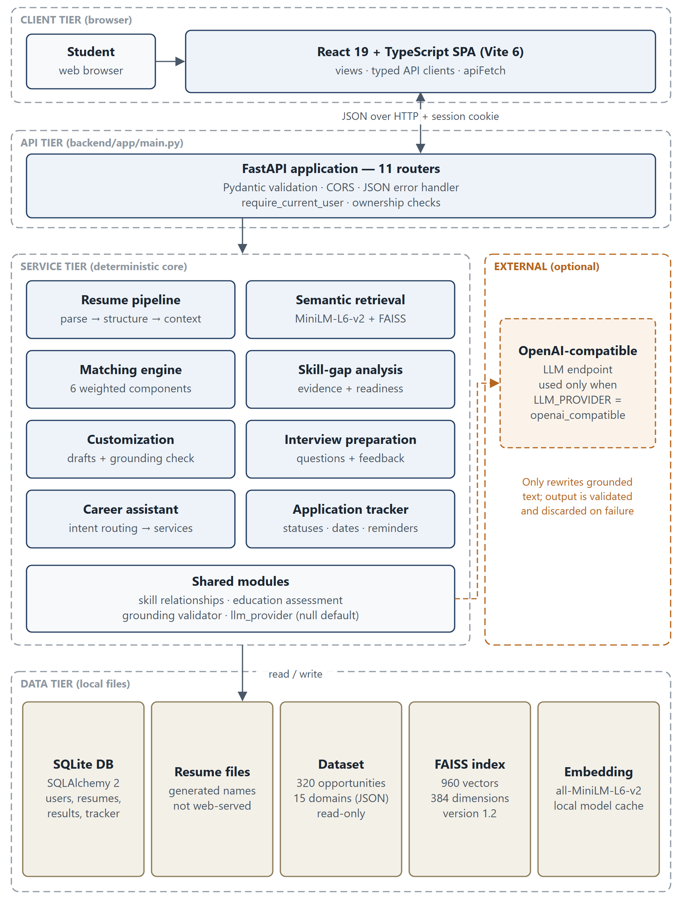

## Component Responsibilities

Table 4.1: Component responsibilities

| Component | Responsibility | Key modules |
|---|---|---|
| React SPA | Views, navigation (History API), typed API clients, empty states | `src/App.tsx`, `src/services/*.ts`, `src/config/api.ts` |
| FastAPI app | Routing, validation (Pydantic), CORS, authentication dependency, error handling | `backend/app/main.py`, `backend/app/api/*.py` |
| Resume pipeline | Upload validation, PDF/DOCX extraction, normalisation, sections, structuring | `resume_validation.py`, `pdf_extraction.py`, `docx_extraction.py`, `text_utils.py`, `section_detection.py`, `structured_resume.py`, `candidate_context.py` |
| Retrieval | Chunking, embeddings, FAISS index, search, query confidence | `job_chunking.py`, `embedding_service.py`, `job_vector_store.py`, `job_search_service.py`, `retrieval_confidence.py` |
| Matching | Profile normalisation, six component scores, explanation | `job_matching.py`, `skill_relationships.py`, `education_assessment.py` |
| Skill gap | Evidence units, requirement classification, readiness | `skill_gap_service.py`, `skill_gap_evidence.py` |
| Customization | Evidence, keyword alignment, drafts, validator, LLM layer, export | `resume_customization_service.py`, `customization_*.py`, `cover_letter_service.py` |
| Interview preparation | Questions, revision topics, mock-answer feedback, LLM layer | `interview_prep_service.py`, `interview_question_service.py`, `interview_mock_service.py`, `interview_llm.py` |
| Assistant | Intent classification, context resolution, handlers, optional synthesis | `assistant_intent.py`, `assistant_context.py`, `assistant_handlers.py`, `assistant_service.py`, `assistant_llm.py` |
| Tracker | Applications, summary, reminders, artifact linking | `application_service.py` |
| Persistence | ORM models and session management | `backend/app/models/*.py`, `backend/app/core/database.py` |

## Data Flow

Figure 4.2 shows the use cases and actors, and Figure 4.3 shows the level-1 data flow with three trust boundaries: the user's device (TB1), the backend process with its local storage (TB2) and the optional external LLM provider (TB3). All requests crossing TB1 → TB2 carry the HttpOnly session cookie. Data crosses TB2 → TB3 only when an LLM provider is configured, and then consists of grounded evidence items and a strict JSON output contract; the response is validated before use or discarded.

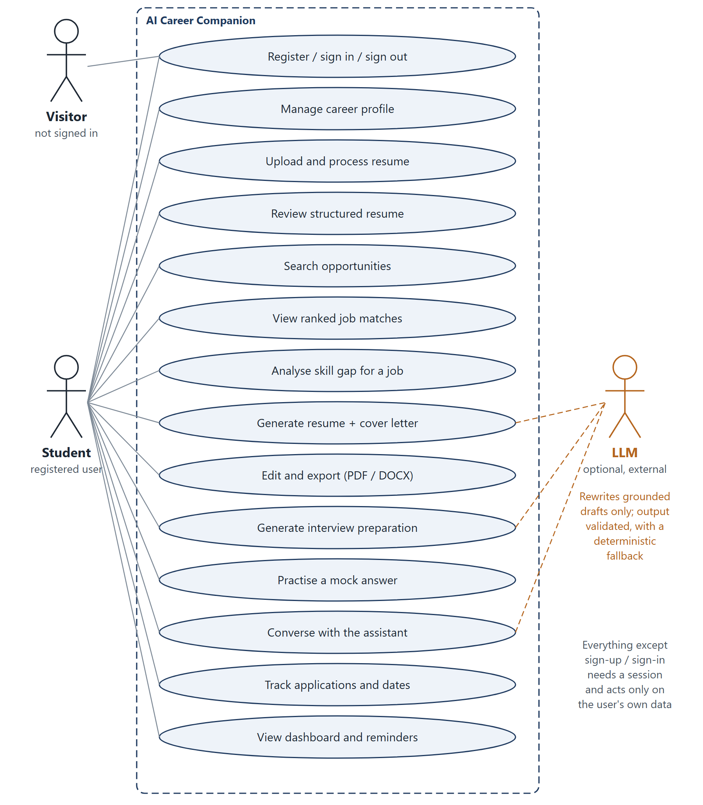

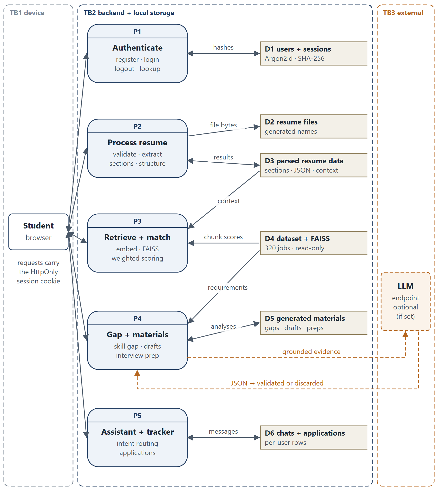

## Database Design

The database is defined by SQLAlchemy 2 models in `backend/app/models` and created with `Base.metadata.create_all`. Figure 4.4, placed on its own page in landscape orientation, shows the entities and relationships. Opportunity data is *not* stored in the database: it is read from the validated JSON dataset and referenced by `job_id`. Four legacy tables (`selected_jobs`, `learning_roadmaps`, `roadmap_items`, `progress_events`) exist in the schema but are not used by any active feature.

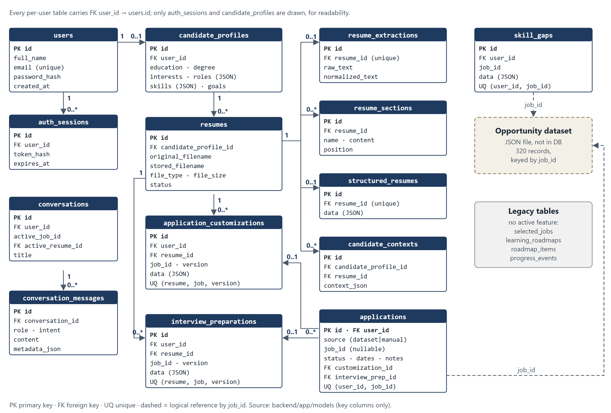{.rotate}

Table 4.2: Principal tables and their purpose

| Table | Purpose | Notable constraints |
|---|---|---|
| `users` | Accounts | unique e-mail; Argon2id `password_hash` |
| `auth_sessions` | Server-side sessions | SHA-256 `token_hash`, `expires_at` |
| `candidate_profiles` | One career profile per user | created at registration |
| `resumes` | Uploaded file metadata | generated `stored_filename` |
| `resume_extractions`, `resume_sections`, `structured_resumes` | Pipeline results | one extraction and one structured result per resume |
| `candidate_contexts` | Profile + structured resume | linked to profile and resume |
| `skill_gaps` | Persisted analyses | unique (`user_id`, `job_id`) |
| `application_customizations`, `interview_preparations` | Versioned generated materials | unique (`resume_id`, `job_id`, `version`) |
| `conversations`, `conversation_messages` | Assistant history | optional active resume |
| `applications` | Tracker entries | unique (`user_id`, `job_id`); optional links to materials |

## Principal Workflow: Resume Upload and Analysis

Figure 4.5 shows the principal workflow. When the user clicks *Process resume*, the SPA calls five endpoints in sequence — upload, extract text, detect sections, structure and candidate context — and stops at the first failure. Each request is authenticated, and each resume or profile is loaded through an ownership-checking helper. The resulting candidate context feeds the job-matching request.

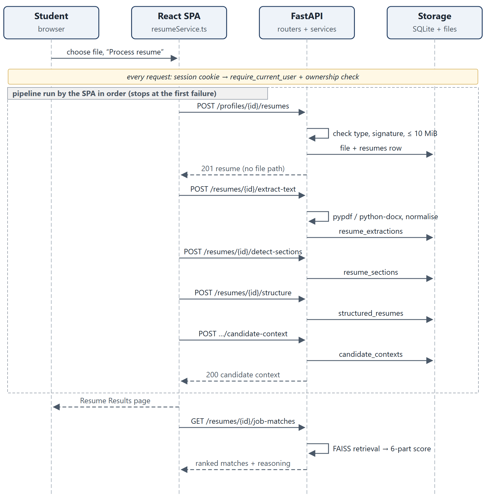

## Optional LLM Path

The LLM path is deliberately separate from the core workflow (Figure 4.6). It begins from a deterministic result that is already grounded. If `LLM_PROVIDER` is `none` (the default), that result is shown with a "Grounded Fallback" label. If it is `openai_compatible`, the service builds a grounded input (evidence items with identifiers, allowed claims, unsupported terms and a JSON output contract), calls the provider's `/chat/completions` endpoint with `response_format = json_object`, and validates the reply against a Pydantic schema and against evidence-ID, unsupported-keyword and fabrication checks. One repair call is allowed; any remaining failure, timeout or HTTP error falls back to the deterministic result with a recorded `fallback_reason`.

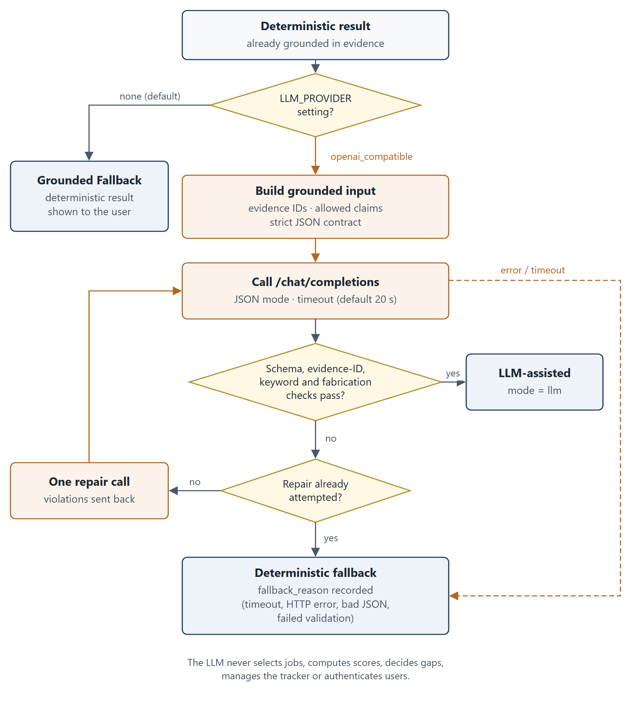

## Authentication and Session Flow

Figure 4.7 shows registration, login, an authenticated request and logout. Passwords are hashed with the `pwdlib` recommended hasher (Argon2id). At login a random token is generated with `secrets.token_urlsafe(48)`; only its SHA-256 hash is stored, with a 14-day expiry, and the raw token is sent once as the `ai_career_session` cookie with `HttpOnly` and `SameSite=Lax`. The cookie is marked `Secure` whenever `APP_ENV` is not `development`. Every protected route depends on `require_current_user`, which hashes the cookie value, looks up the session and checks its expiry. On the client, any HTTP 401 dispatches a session-expired event that returns the user to the sign-in page.

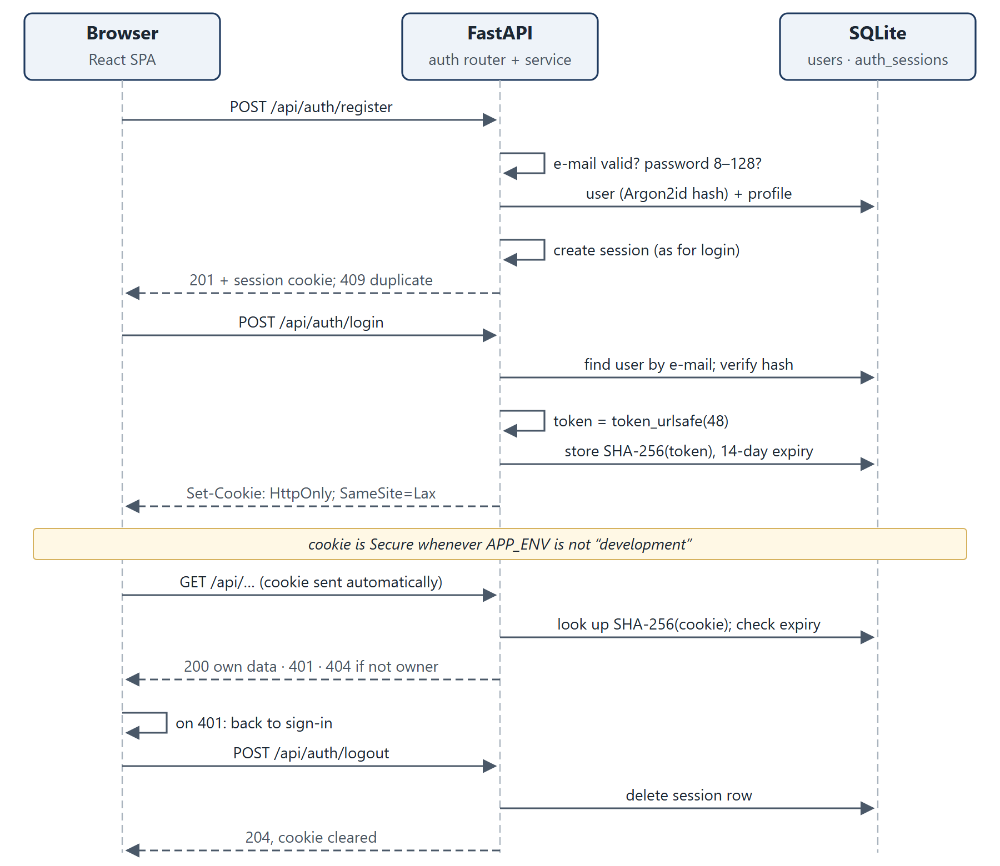

## Key Design Decisions and Rationale

Table 4.3: Key design decisions

| Decision | Rationale | Trade-off |
|---|---|---|
| Deterministic core, optional LLM | Reproducible, explainable, testable offline, no API cost; avoids fabricated claims | General career questions are answered only with a capability message in deterministic mode |
| Retrieval selects records; structured data drives reasoning | Scores and gaps are computed from canonical requirements, not from retrieved text | Quality depends on the curated schema and skill vocabulary |
| Exact `IndexFlatIP` on normalised vectors | 960 vectors are small enough for exact cosine search | Would need an approximate index at much larger scale |
| Three chunks per posting with title/type prefix on the overview | Accepted in experiment E8-V3: improved Hit@1 without diluting skill chunks | Requires index rebuild when the template changes |
| Components without evidence are excluded from the score | Avoids penalising a candidate for information that cannot be assessed | Scores from different evidence sets are not strictly comparable |
| Related-skill credit only for preferred skills | A hard requirement needs direct evidence | Some semantically related candidates still score low |
| Opaque server-side sessions, not JWT | Logout and expiry are enforced server-side; token never readable by scripts | Requires a database lookup per request |
| 404 for foreign objects | Does not reveal whether another user's object exists | Slightly less specific error |
| SQLite with `create_all` | Zero-configuration local persistence | No migration framework (Chapter 10) |

# Methodology and Algorithms

## Resume Upload and Validation

Upload validation (`resume_validation.py`) checks content rather than trusting the file name. A file must have a `.pdf` or `.docx` extension, be non-empty and at most 10 MiB (`MAX_RESUME_SIZE = 10 * 1024 * 1024`), and its bytes must match the declared type: PDFs are opened with `pypdf`, and DOCX files are checked as ZIP archives containing the required XML parts. A valid file is stored under a generated name in `RESUME_STORAGE_DIR`; the internal path is never returned to the client. Invalid files are rejected without being persisted.

## Text Extraction and Normalisation

PDF text is extracted with `pypdf`. Some generators (notably documents exported from Google Docs) draw every word as a separate text object, which makes the default extraction emit one word per line; when this "word-fragmented" pattern is detected, each page is rebuilt from the positions of its text runs in content-stream order. DOCX extraction reads the page header, body paragraphs, table rows and floating text boxes in document order. The text is then normalised: ligatures are expanded, invisible and zero-width characters are removed, typographic spaces are converted, and lone bullet glyphs are reattached to their lines. Image-only PDFs fail explicitly, because OCR is not implemented.

## Section Detection and Structuring

Section detection is deterministic and alias-based: recognised headings include summary, skills, education, experience, internships, projects, certifications and languages. An unrecognised all-caps line becomes a custom heading only when its context reads like one — it contains no digits, does not continue a wrapped all-caps line, is not the first line under another heading, and is followed by content.

The structuring step extracts skills, education, experience, projects, certifications, languages and a summary into JSON, stamped with a `parser_version` (currently 4) and a list of `parser_warnings`. Project records that look like parsing fragments are kept in the stored data but excluded from evidence by every downstream service through one shared rule (`is_reliable_project`). Results produced by an older parser are served with an `outdated_parser_version` warning and can be reprocessed from the stored original file; stored data is never rewritten silently.

## Candidate Context

The candidate context combines the saved career profile with the structured resume and is the input to every later service. Skills that appear only in the profile, and not in the resume's skills, projects or experience, are treated as **self-reported**: they still count for matching, but they are listed separately and are described with lower confidence in the skill-gap analysis (0.70 instead of 0.95).

## Sentence Embeddings and Opportunity Representation

The embedding model is `sentence-transformers/all-MiniLM-L6-v2`, a compact Sentence-Transformers model [1], [3] that maps text to a **384-dimensional** vector; the dimension is recorded in the index metadata (`embedding_dimension: 384`). Vectors are L2-normalised, so the inner product of two vectors equals their cosine similarity. The model is loaded from the local Hugging Face cache first and downloaded only on a cache miss when `EMBEDDING_ALLOW_DOWNLOAD` is true.

Each opportunity in the catalogue is split into three chunks — `overview`, `requirements` and `responsibilities` — with stable identifiers such as `JOB-0001::requirements`. Since index version 1.2 the overview chunk begins with the title and employment type (for example "Data Analyst Intern (Internship). "). The 320 records therefore yield 960 chunk vectors.

## FAISS Indexing and Similarity Retrieval

The vectors are stored in an exact FAISS `IndexFlatIP` [2]. Let $\mathbf{e}_q$ be the normalised embedding of the query $q$ and $\mathbf{e}_c$ the normalised embedding of chunk $c$. The chunk similarity is

$$ s(q, c) = \mathbf{e}_q \cdot \mathbf{e}_c = \cos(\mathbf{e}_q, \mathbf{e}_c) $$

Every chunk is searched. For an opportunity $j$ with chunks $C_j$, let $s_{(1)} \ge s_{(2)} \ge \dots$ be its chunk similarities in descending order. The opportunity's retrieval score is

$$ S(q, j) = s_{(1)} + 0.05 \sum_{k \ge 2} s_{(k)} $$

so the best-matching chunk dominates and the other chunks act as a small tie-breaker. Opportunities are sorted by $S$ and the top $k$ are returned ($1 \le k \le 20$; the default is 5 for search and 10 for matching). This aggregation is implemented in `job_search_service.py`:

```python
best_score = matches[0][0]
additional_score = sum(score for score, _ in matches[1:]) * 0.05
```

### Query-Confidence Flag

Similarity scores alone cannot separate off-topic queries from genuine ones: in the M4.2 baseline, an out-of-coverage query ("UI UX design") scored higher than some genuine skill-only queries. Instead, `retrieval_confidence.py` measures **query-term coverage**. Let $T_q$ be the content words of the query after removing stop words and generic opportunity words (such as "internship" or "graduate"), and let $V$ be the vocabulary of words found in catalogue titles, domains and required and preferred skills. Then

$$ \mathrm{coverage}(q) = \frac{|\{t \in T_q : t \in V\}|}{|T_q|} $$

with a plural-tolerant membership test and $\mathrm{coverage}(q) = 0$ when $T_q$ is empty. A query is labelled `confident` if coverage is at least 0.5 and `unsupported_area` otherwise. The label is a notice only: results are never suppressed.

## Deterministic Matching and Ranking

Retrieval decides *which* opportunities are considered; a deterministic scorer decides their order and explanation (Figure 5.1). The retrieval query is either an explicit query (for example, a discovery request to the assistant) or the first 40 normalised candidate terms (skills, target roles, interests, education and project text). Each retrieved opportunity $j$ is scored on six components $i$, each giving a score $s_i \in [0, 1]$ or "not applicable".

Table 5.1: Matching components and weights (`MATCH_WEIGHTS` in `job_matching.py`)

| Component $i$ | Weight $w_i$ | Component score $s_i$ |
|---|---:|---|
| Required skills | 0.35 | share of required skills matched exactly or by alias |
| Preferred skills | 0.15 | (exact matches + 0.5 × related-skill matches) / preferred skills |
| Experience | 0.15 | rule-based: 1.0 when no prior experience is required or the stated duration is met; 0.6 for partial evidence; 0.0 when no evidence exists |
| Project relevance | 0.15 | overlap between the job's terms and the candidate's project terms |
| Education | 0.10 | shared education assessment: met 1.0, partial 0.5, not met 0.0; unknown → not applicable |
| Qualifications | 0.10 | share of the job's qualification terms found in certifications and achievements; no such evidence → not applicable |

With $A$ the set of applicable components, the match score is

$$ M(j) = 100 \times \frac{\sum_{i \in A} w_i \, s_i}{\sum_{i \in A} w_i} $$

rounded to one decimal place. Results are then sorted by match score (descending), retrieval score (descending) and `job_id`. The code is short enough to quote in full:

```python
def _match_score(components: dict[str, ComponentResult]) -> float:
    active = {name: result for name, result in components.items() if result.score is not None}
    total_weight = sum(MATCH_WEIGHTS[name] for name in active)
    weighted = sum(result.score * MATCH_WEIGHTS[name] for name, result in active.items() if result.score is not None)
    return round(weighted / total_weight * 100, 1) if total_weight else 0.0
```

Related-technology credit, from a shared table in `skill_relationships.py`, is given **only to preferred skills**; a related skill remains listed as missing, with an explanation. Experiment E3 (Section 7.7) showed that granting the same credit to required skills let a candidate with one of four required skills overtake a candidate with three of four, so that variant was rejected.

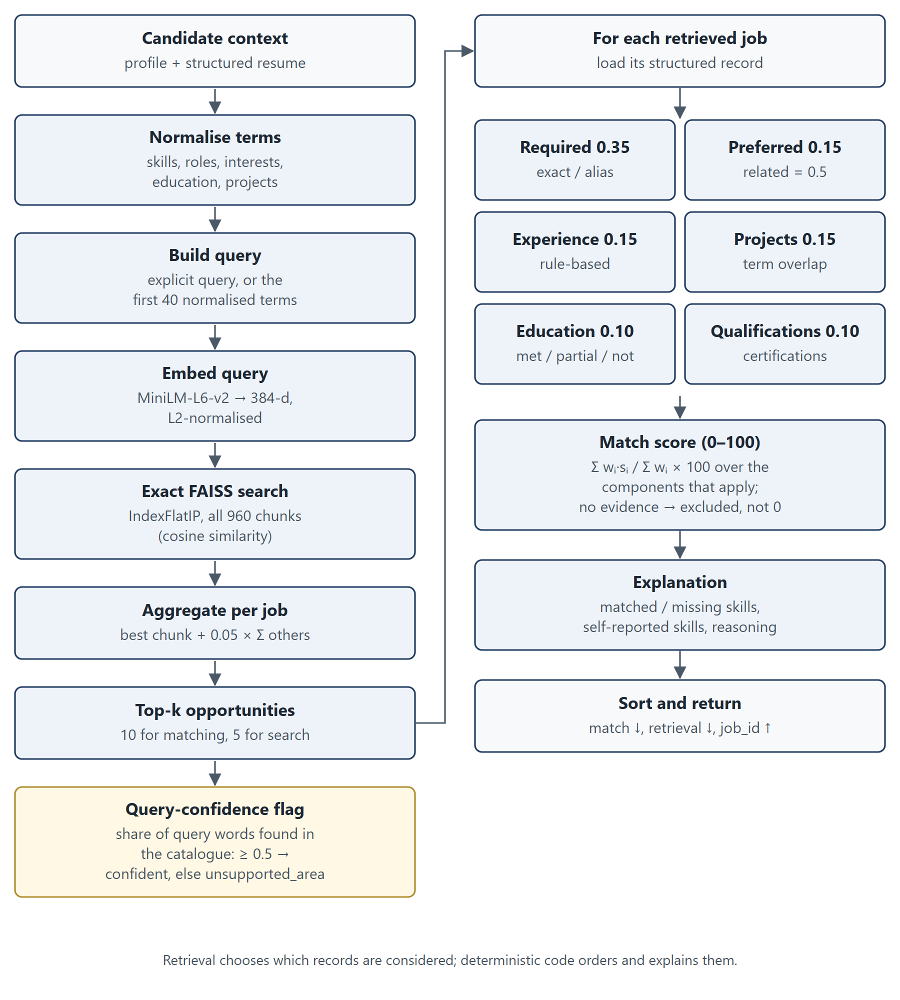

## Skill Extraction and Skill-Gap Generation

The skill-gap analysis (`skill_gap_service.py`, `skill_gap_evidence.py`) compares the candidate with one selected opportunity, requirement by requirement. The candidate's evidence is broken into evidence units (resume skills, reliable projects, experience, education, certifications and profile fields). Each required skill, preferred skill and qualification is classified as **demonstrated**, **partial** (supported by a related technology), **learning only** (mentioned only as something being learned) or **missing**, with quoted evidence, a severity and a recommendation. Learning-only mentions never count as demonstrated, and a missing preferred skill is never reported as a critical gap.

Readiness is a separate deterministic score, intentionally different from the match score. Each component $k$ receives the mean partial credit $r_k$ of its items (demonstrated 1.0, partial 0.5, learning only 0.1, missing 0.0), and

$$ R = \mathrm{round}\!\left(100 \times \frac{\sum_{k \in K} v_k \, r_k}{\sum_{k \in K} v_k}\right) $$

where $K$ is the set of components with evidence and the weights $v_k$ are: required skills 0.40, preferred skills 0.15, experience 0.20, education 0.10 and qualifications 0.15. Education is assessed by the same `education_assessment` module as matching, so the two services cannot disagree about the same pair.

```text
Algorithm: skill-gap analysis for resume r and opportunity j
  units <- evidence units from the structured resume
           (reliable projects only) and the profile
  for each requirement x in required(j), preferred(j), qualifications(j):
      if exact or alias evidence for x exists:  demonstrated (quote it)
      else if a related technology is evidenced: partial (name it)
      else if x appears only as "learning":       learning_only
      else:                                       missing
      add severity (missing required = critical) and a recommendation
  assess experience and education (shared education_assessment)
  readiness <- weighted mean of component credits (components with evidence)
  persist the (user, job) analysis; mark it stale if r is reprocessed
```

## Grounding and Evidence Validation

Customization and interview preparation are first produced deterministically from evidence records that carry identifiers. Keyword alignment labels each job keyword as supported (direct evidence), partially supported (related evidence) or unsupported. The grounding validator (`customization_validator.py`) then checks every generated sentence (Figure 5.2) for:

- **unsupported keywords** — a job term that the evidence does not support (the target job title and company name are allowed);
- **fabrication patterns** — invented metrics (percentages, "by 3×"), leadership claims ("led a team", "team of 5") and "N years of experience";
- **unsupported claims** — technologies, degrees, employers, awards and quoted project names absent from the evidence.

A sentence that fails any check is removed and recorded in `removed_claims` with a warning. A result is reported as *passed* only if nothing was removed and no parser-warning notice applies. User edits are re-validated on save, and generation is refused with HTTP 409 when only unreliable project fragments remain.

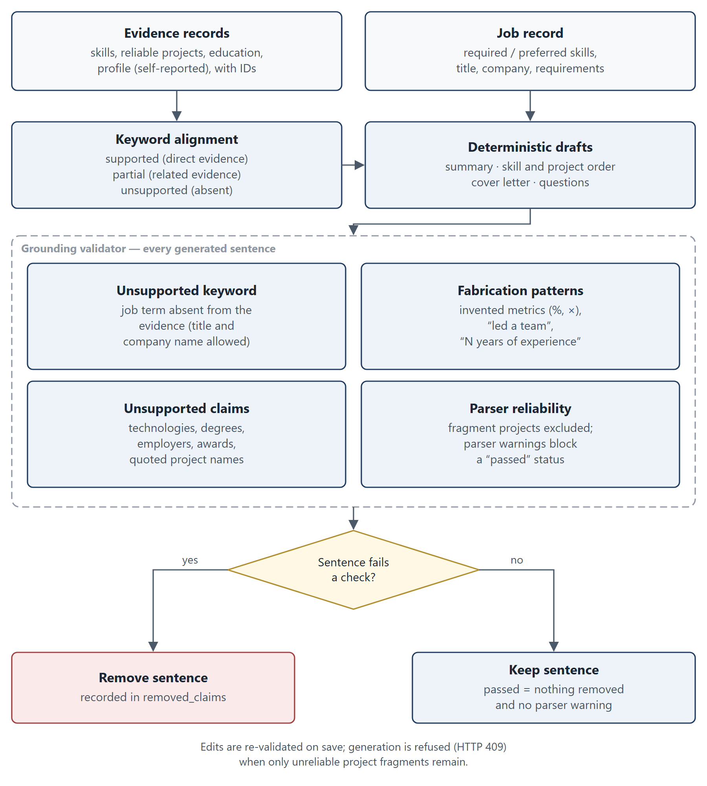

## Semantic Similarity, Deterministic Scoring and LLM Wording

Three different mechanisms are often conflated, so they are distinguished here:

1. **Semantic similarity** (embeddings and FAISS) measures how related two texts are. It is used only to choose candidate opportunities and to order search results.
2. **Deterministic scoring** (match score, readiness, keyword support, reminders) applies explicit rules to structured data. It produces every number the user sees.
3. **Optional LLM wording** rephrases text that has already been produced and grounded. It never chooses opportunities, computes scores, decides gaps, manages the tracker or authenticates users. The source code supports no stronger claim than this.

## Optional LLM-Assisted Rewriting and Fallback

The LLM provider (`llm_provider.py`) is a small `httpx` client for any OpenAI-compatible `/chat/completions` endpoint; no vendor SDK is used. It is used by customization, interview preparation and assistant answer synthesis. The algorithm, for each generation request, is:

```text
result <- deterministic grounded result
if provider is NullLLMProvider:
    return result                    (fallback_reason = no_provider_configured)
try:
    raw <- provider.generate_json(grounded input, JSON contract, timeout)
except timeout, HTTP error or invalid JSON:
    return result                    (fallback_reason recorded)
violations <- schema, evidence-ID, unsupported-keyword, fabrication checks
if violations:
    raw <- one repair call with the violations   (failure -> fallback)
    violations <- the same checks
if violations: return result         (fallback_reason = validation failure)
return LLM-assisted result           (generation_mode = "llm")
```

The provider records token usage when the endpoint reports it; nothing is estimated. The API key is read from the environment and never logged.

## Conversational Assistant

The assistant classifies each message deterministically into one of eleven intents: job discovery, match explanation, skill gap, resume customization, cover letter, interview preparation, learning guidance, job comparison, profile summary, next best action and general career chat. A context resolver carries the active resume and the job in focus across turns without leaking a previous job. Handlers call the same matching, skill-gap, customization and interview services, so the assistant never computes its own scores. Discovery retrieves the *requested* area while scoring against the resume. General career questions (for example, salary negotiation) receive a fixed capability message in deterministic mode — limitation CV06.

## Data Persistence and Retrieval

All persistent state is stored through SQLAlchemy sessions in SQLite. Pipeline results are upserted per resume; generated materials are versioned per (resume, job), with version allocation retried on a concurrent conflict; skill-gap analyses are unique per (user, job) and are flagged stale when the resume is reprocessed. The opportunity dataset and the vector store are cached in-process, keyed by file path, modification time and size (plus the model name for the index), and are re-validated when a file changes. No user data is cached.

## Error Handling and Validation

Request bodies and query parameters are validated by Pydantic; for example, `top_k` must lie between 1 and 20 and passwords must have 8–128 characters. Domain errors map to explicit HTTP codes (400 for invalid files, 404 for missing or foreign objects, 409 for duplicates and insufficient evidence, 422 for schema violations). Unexpected exceptions are logged and returned as a generic JSON 500 *inside* the CORS layer, so the browser can read the error instead of reporting a network failure. On the client, `apiDetailMessage` turns FastAPI 422 lists into readable text and replaces 5xx details with a generic message.

# Implementation

## Frontend Architecture and Major Screens

The frontend is a React 19 + TypeScript single-page application built with Vite 6 and styled with plain CSS. There is no router library: `src/App.tsx` maps URLs to views and drives the browser History API. Feature services in `src/services/*.ts` call the backend through `apiFetch` in `src/config/api.ts`, a credentialed `fetch` wrapper that dispatches a session-expired event on HTTP 401. Figure 6.1 shows the screen map.

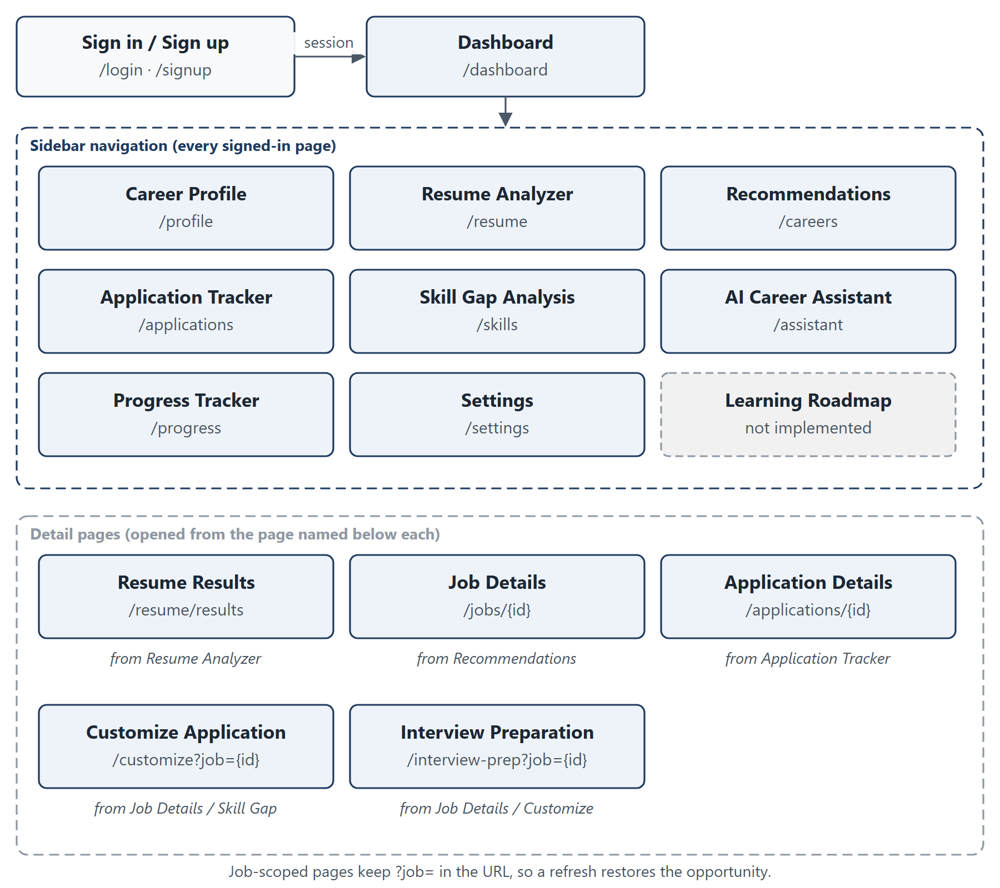

Table 6.1: Major screens

| Screen | Purpose |
|---|---|
| Dashboard | Next best action, resume status, extracted skills, matches and application activity — all from real data |
| Career Profile | Edit education, degree, interests, target roles, skills and goals |
| Resume Analyzer / Results | Upload, process and review the structured resume; reprocess outdated results |
| Career Recommendations | Ranked matches for the resume and free-text opportunity search with the confidence notice |
| Job Details | Full opportunity record, "Check my match", links to gap analysis, customization, interview prep and the tracker |
| Skill Gap Analysis | Readiness, critical, partial and preferred gaps with quoted evidence |
| Customize Application | Keyword alignment, tailored summary, ordered skills and projects, cover letter, export |
| Interview Preparation | Categorised questions, revision topics, mock-answer practice |
| AI Career Assistant | Persisted conversations with intent-routed answers |
| Application Tracker / Details | Summary cards, filters, upcoming actions, status, dates, notes, linked materials |
| Progress Tracker | Profile and resume completion from saved fields |
| Learning Roadmap | States that roadmap generation is not available (not implemented) |

UI screenshots are not included in this report because none were captured from the canonical baseline; Figure 6.1 is a structural diagram, not a screenshot.

## Backend Structure and API Design

The backend (`backend/app`) is organised into `api` (11 routers), `schemas` (Pydantic request and response models), `services` (business logic), `models` (SQLAlchemy entities) and `core` (settings and database). Settings are read from `backend/.env` through pydantic-settings, with process environment variables taking precedence. The API exposes 47 operations (Appendix A), documented interactively at `/docs` with the schema at `/openapi.json`. The API is resource-oriented: resume-derived resources are nested under `/api/resumes/{resume_id}`, and tracker resources live under `/api/applications`.

## Authentication and Session Handling

Registration (`POST /api/auth/register`) validates the name, e-mail (Pydantic `EmailStr`) and password (8–128 characters, confirmed), case-folds the e-mail, rejects duplicates, hashes the password with Argon2id and creates an empty career profile in the same transaction. Login creates a server-side session as described in Section 4.7; the relevant code is:

```python
raw_token = secrets.token_urlsafe(48)
session = AuthSession(user_id=user.id, token_hash=_token_hash(raw_token),
                      expires_at=datetime.now(timezone.utc) + timedelta(days=SESSION_DAYS))
...
response.set_cookie(SESSION_COOKIE, raw_token, httponly=True, samesite="lax",
                    secure=session_cookie_secure(), max_age=SESSION_DAYS * 86400)
```

Logout deletes the session row and clears the cookie. Ownership helpers (`get_owned_profile`, `get_owned_resume` and service-level filters) ensure that every query is restricted to the current user.

## Resume Upload and Analysis

The Resume Analyzer accepts a file through the browser's file input and mirrors the backend limits for faster feedback; the backend remains authoritative. Processing runs the five pipeline calls in order with a visible stage indicator. The Results page shows extracted skills, education (with parsed degree and graduation badges), experience or "No experience extracted", structured project entries with a "Not used as evidence" badge for unreliable fragments, languages and parser warnings, and offers *Reprocess with current parser* for results from an older parser version. *Limitations:* no OCR; experience is one entry per section rather than per role; the position-based PDF rebuild is heuristic and was verified on the observed Google Docs layout and on synthetic fixtures only.

## Career and Opportunity Recommendations

`GET /api/resumes/{resume_id}/job-matches` returns up to 20 (default 10) ranked matches, each with the match score, component scores, matched and missing required and preferred skills, related-skill explanations, self-reported skills and a reasoning string that names the supporting project by title. The Careers page also offers free-text search through the public `GET /api/jobs/search` endpoint and shows a notice when a query is labelled `unsupported_area`. *Limitations:* recommendations come only from the curated 320-record catalogue in 15 technology domains; within a domain, postings share the same skill lists, which limits how finely the ranking can separate them.

## Skill-Gap Analysis

`POST /api/resumes/{resume_id}/skill-gap` analyses one opportunity and persists the result; `GET …/skill-gap/{job_id}` reloads it and reports whether it is stale. The page shows overall readiness, required and preferred counts, critical and partial gaps with quoted evidence, and recommendations. *Limitation:* recommendations are rule-based text; there is no learning-resource catalogue.

## Resume Customization and Cover Letter

`POST /api/resumes/{resume_id}/application-customizations` produces a versioned result containing keyword alignment, a tailored professional summary, reordered skills, ranked projects with tailored skill lists and a cover letter, each item listing its evidence IDs. Results can be edited (edits are re-validated), regenerated and exported as PDF (`reportlab`) or DOCX (`python-docx`) via `GET …/{customization_id}/export?format=pdf|docx`, and linked to a tracker entry. The UI labels each result "Grounded Fallback" or LLM-assisted and shows whether the grounding check passed. *Limitation:* deterministic wording is template-based and therefore less varied than human writing.

## Interview Preparation

`POST /api/resumes/{resume_id}/interview-preparations` generates questions in six categories — technical, resume, project, role, HR and skill-gap — with easy, medium and hard difficulty levels and prioritised revision topics, each question carrying its source. `POST …/{prep_id}/mock-answer` returns structured feedback on a practice answer (strengths, improvements, missing points and a suggested structure). The optional LLM layer follows the same contract as customization. *Limitation:* mock-answer feedback is rule-based in deterministic mode and is not a substitute for human assessment.

## Application Tracking and Persistence

The tracker (`application_service.py`, `/api/applications`) supports two sources: an opportunity tracked from Careers (`source = dataset`), whose company, title, type, location, work mode and description are copied server-side from the catalogue, and a manual entry (`source = manual`). Ten statuses are supported: saved, planning, applied, under_review, shortlisted, interview_scheduled, interview_completed, offer, rejected and withdrawn. Users enter the application date, deadline, follow-up date, interview date-time (stored in UTC) and interview status, together with notes. A dataset opportunity can be tracked once per user (a second attempt returns 409), while manual entries are unlimited. Customizations and interview preparations can be linked only if they belong to the same user and job.

The summary endpoint returns total, active, completed, upcoming-deadline, scheduled-interview, offer and rejected counts. The reminders endpoint (`?days=1–60`, default 7) applies four date rules: deadlines within the window for pre-application items, interviews within the window, due or overdue follow-ups, and applied or under-review items unchanged for 14 days. *Limitation:* deadlines are never inferred, because the catalogue contains none; reminders are shown in the application only (no e-mail or push notifications).

## Career Assistant and Opportunity Discovery

`/api/career-assistant/conversations` stores conversations and messages per user. Each message is classified, its context resolved and the matching handler invoked; responses can carry suggested actions that navigate to the relevant page. Discovery requests such as "Find internships in cybersecurity" strip the discovery wording, retrieve opportunities for the remaining area words and score them against the resume. *Limitations:* intent classification uses deterministic rules, so unusual phrasing may be routed to general chat; general career questions are limited in deterministic mode (CV06).

## Database Models and Relationships

The models and relationships are shown in Figure 4.4 and Table 4.2. Tables are created at startup with `create_all`; a small helper in `backend/app/core/database.py` adds columns that older local SQLite files lack. Relative SQLite and resume-store paths are resolved against the backend directory, so launching the server from a different working directory cannot silently create a second database.

## Configuration and Optional LLM Integration

Table 6.2: Principal configuration settings (`backend/app/core/config.py`)

| Setting | Default | Effect |
|---|---|---|
| `APP_ENV` | `development` | Enables the localhost CORS rule and a non-Secure cookie in development |
| `FRONTEND_URL` | `http://localhost:5173` | Exact allowed CORS origin |
| `SESSION_COOKIE_SECURE` | automatic | Overrides the Secure-cookie default |
| `DATABASE_URL` | SQLite file under `backend/data` | Database location |
| `RESUME_STORAGE_DIR` | `./data/resumes` | Private resume store |
| `EMBEDDING_MODEL_NAME` | `sentence-transformers/all-MiniLM-L6-v2` | Embedding model |
| `EMBEDDING_ALLOW_DOWNLOAD` | `true` | Allow a one-time model download on a cache miss |
| `LLM_PROVIDER` | `none` | `none` or `openai_compatible` |
| `LLM_MODEL`, `LLM_BASE_URL`, `LLM_API_KEY` | unset | Provider details (key read from the environment only) |
| `LLM_TIMEOUT_SECONDS` | 20 | Per-call timeout |

The frontend reads `VITE_API_BASE_URL` at build time (default `http://localhost:8000`).

## Error Handling, Validation and Security-Related Choices

Uploads are validated by signature and structure; malformed or oversized files return 400 without persistence. Customization and interview generation return 409 when the evidence is insufficient. Concurrent generation requests that collide on a version number are retried rather than failing with a 500. The frontend uses `fetchWithTimeout` for long generation requests and tells the user honestly that aborting does not cancel server work. No browser storage holds account data. Security mechanisms are described in Chapter 9.

# Testing and Evaluation

## Testing Methodology

Testing combined four layers: (i) unit and service tests for each backend module; (ii) API tests through FastAPI's `TestClient`, including authentication and cross-user isolation; (iii) evaluation-backed tests that encode the M4.2 baseline as invariants, regression floors and strict expected failures (`xfail`); and (iv) an offline evaluation framework that measures retrieval, matching, consistency, grounding, service hand-off and conversation behaviour. The frontend was checked with strict TypeScript type checking, ESLint, a production build and a manual browser walkthrough.

## Test Environment and Configuration

Tests run against per-test temporary SQLite databases and resume folders. A suite-wide guard replaces every LLM-provider binding with `NullLLMProvider`, so a real key in `backend/.env` can never be used; LLM behaviour is tested with explicit fake providers. The evaluation framework forces `LLM_PROVIDER=none`, sets `HF_HUB_OFFLINE=1` and uses an in-memory database. The M4.4 verification was performed on 2026-10-05 on Windows 11 with Python 3.12.3; the re-runs reported in this chapter were performed on 2026-10-16 on the same development setup.

## Unit, Integration, API and Regression Tests

Table 7.1: Backend test coverage by area (`backend/tests`)

| Area | Representative test modules |
|---|---|
| Authentication and sessions | `test_auth_api.py`, `test_auth_persistence.py`, `test_session_cookie.py`, `test_cors.py` |
| Resume pipeline | `test_resume_api.py`, `test_pdf_extraction.py`, `test_docx_extraction.py`, `test_section_detection.py`, `test_structured_resume_parser.py`, `test_resume_parser_robustness.py`, `test_resume_parser_real_world.py` |
| Retrieval | `test_job_dataset_service.py`, `test_job_chunking.py`, `test_job_vector_store.py`, `test_job_search_service.py`, `test_job_retrieval_integration.py`, `test_jobs_api.py` |
| Matching | `test_job_matching.py`, `test_job_matching_api.py`, `test_job_matching_integration.py` |
| Skill gap | `test_skill_gap_service.py`, `test_skill_gap_evidence.py`, `test_skill_gap_api.py` |
| Customization and LLM layer | `test_customization_service.py`, `test_customization_validator.py`, `test_customization_llm.py`, `test_customization_quality.py`, `test_customization_api.py` |
| Interview preparation | `test_interview_prep_service.py`, `test_interview_prep_api.py` |
| Assistant | `test_assistant_intent.py`, `test_assistant_service.py`, `test_assistant_api.py` |
| Tracker | `test_application_service.py`, `test_applications_api.py` |
| Evaluation and regression | `test_m4_2_evaluation_framework.py`, `test_m4_2_baseline.py`, `test_m4_2_e2e_workflow.py`, `test_m4_3_optimizations.py`, `test_resume4_regressions.py`, `test_video_audit_regressions.py` |

## Representative Test Cases

Table 7.2 lists representative test cases and Table 7.3 names the automated test behind each one; "Actual" records the outcome of the 2026-10-16 suite run, in which every listed test passed.

Table 7.2: Representative test cases

| ID | Precondition | Steps | Expected | Actual |
|---|---|---|---|---|
| TC-01 | Empty database | Register a user | One user and exactly one linked profile | Pass |
| TC-02 | Logged-in user | Log out, call `/api/auth/me` | Session removed; 401 | Pass |
| TC-03 | User with profile | Upload mismatched, corrupt and oversized files | 400 for each; nothing persisted | Pass |
| TC-04 | Two users | User B accesses user A's profile and resume | 404 | Pass |
| TC-05 | Index loaded | Search a query | Unique jobs, chunk scores aggregated | Pass |
| TC-06 | Structured resume | Request matches | Ordered by match score | Pass |
| TC-07 | Resume, job | Analyse gap | Missing preferred skill not critical | Pass |
| TC-08 | Resume, job | Analyse twice | Identical readiness | Pass |
| TC-09 | Evidence corpus | Validate a sentence with an invented metric | Sentence removed | Pass |
| TC-10 | Fake provider that times out | Generate | Deterministic fallback, no repair | Pass |
| TC-11 | Fake provider returning bad JSON | Generate | One repair, then fallback | Pass |
| TC-12 | Tracked job | Track it again; add manual lookalike | 409; manual allowed | Pass |
| TC-13 | Catalogue job | Track it | No deadline set | Pass |
| TC-14 | Empty database | Register → … → tracker → logout/login; second user probes | Every step succeeds; second user gets 404 | Pass |
| TC-15 | Development settings | Preflight from an unknown origin | Rejected | Pass |
| TC-16 | Deterministic mode | Ask a general career question | Recorded known failure | Expected failure (xfail) |

Each test case is implemented by the automated test listed in Table 7.3 (all in `backend/tests`).

Table 7.3: Automated tests implementing the test cases

| ID | Automated test (module :: function) |
|---|---|
| TC-01 | `test_auth_api` :: `test_register_creates_user_and_one_linked_profile` |
| TC-02 | `test_auth_api` :: `test_logout_invalidates_session` |
| TC-03 | `test_resume_api` :: `test_rejects_mismatched_corrupt_and_oversized_uploads_without_persistence` |
| TC-04 | `test_resume_api` :: `test_user_cannot_access_or_upload_to_another_users_profile_or_resume` |
| TC-05 | `test_job_search_service` :: `test_search_aggregates_chunks_into_unique_jobs` |
| TC-06 | `test_job_matching` :: `test_matching_service_ranks_by_match_score_not_retrieval_order` |
| TC-07 | `test_skill_gap_service` :: `test_preferred_missing_skill_never_lands_in_critical_gaps` |
| TC-08 | `test_skill_gap_service` :: `test_determinism_same_inputs_produce_identical_score` |
| TC-09 | `test_customization_validator` :: `test_fabricated_metric_is_rejected` |
| TC-10 | `test_customization_llm` :: `test_provider_timeout_falls_back_without_a_repair_attempt` |
| TC-11 | `test_customization_llm` :: `test_malformed_json_shape_triggers_repair_then_fallback` |
| TC-12 | `test_applications_api` :: `test_duplicate_dataset_application_is_rejected_but_manual_lookalikes_are_allowed` |
| TC-13 | `test_applications_api` :: `test_dataset_application_never_derives_a_deadline` |
| TC-14 | `test_m4_2_e2e_workflow` :: `test_complete_student_workflow_from_profile_to_application_tracking` |
| TC-15 | `test_cors` :: `test_options_preflight_rejected_for_unknown_origin` |
| TC-16 | `test_m4_2_baseline` :: `test_general_career_question_gets_a_substantive_answer` (strict `xfail`) |

## Test Results

Table 7.4: Backend test-suite results over the project history

| Run | Date | Code state | Result | Source |
|---|---|---|---|---|
| M4.2 baseline | before M4.3 | `develop` before optimisation | 374 passed, 6 xfailed | Final technical documentation, §1 |
| M4.4 release audit | 2026-10-05 | `develop`, M4.4 | 464 passed, 0 failed, 1 xfailed, 2 warnings (39.2 s) | Final technical documentation, §21 |
| After resume-parsing audit | 2026-10-10 | `develop` (commit `4699c7c`) | 547 passed, 1 xfailed | `README.md`; `docs/RESUME_PARSING_AUDIT.md` |
| Re-run for this report | 2026-10-16 | current checkout (`develop` plus test-isolation work) | 555 passed, 0 failed, 1 xfailed, 2 warnings (33.4 s) | Re-run during report preparation |

The single expected failure is the strict `xfail` for CV06. The two warnings are third-party deprecation notices (the Starlette `httpx`-based TestClient and an `anyio` alias). The increase from 464 to 547 tests reflects the regression tests added in the resume-parsing audit; the further 8 tests in the current checkout come from test-isolation work that is not yet merged into `develop` (Section 7.12).

## Retrieval-Quality Evaluation

The M4 evaluation framework (`backend/app/services/m4_evaluation.py`, `backend/scripts/run_m4_evaluation.py`) uses 26 labelled positive queries with 136 relevant and 612 acceptable job labels, 12 off-topic queries, 5 synthetic candidates forming 8 candidate–job pairs, 4 matching scenarios, 7 scripted conversations with 16 turns and 3 job-discovery probes. Labels are derived from explicit rules (domain plus exact titles and/or employment types), and a test re-derives every label from its rule. The metrics follow standard information-retrieval definitions [4], [5]: Hit@$k$ is 1 if a relevant job appears in the top $k$; Precision@$k$ and Recall@$k$ count relevant jobs in the top $k$ relative to $k$ and to all relevant jobs; MRR@10 averages the reciprocal rank of the first relevant job; and nDCG@$k$ uses graded gains of 3 for relevant and 1 for acceptable jobs.

Table 7.5: Retrieval metrics on 26 labelled queries

| Metric | M4.2 frozen baseline | M4.3 final |
|---|---:|---:|
| Hit@1 / @3 / @5 / @10 | 0.885 / 1.000 / 1.000 / 1.000 | 1.000 / 1.000 / 1.000 / 1.000 |
| Precision@1 / @3 / @5 / @10 | 0.885 / 0.833 / 0.654 / 0.396 | 1.000 / 0.846 / 0.662 / 0.404 |
| Recall@1 / @3 / @5 / @10 | 0.314 / 0.738 / 0.874 / 0.926 | 0.404 / 0.751 / 0.883 / 0.936 |
| nDCG@1 / @3 / @5 / @10 | 0.923 / 0.968 / 0.961 / 0.938 | 1.000 / 0.984 / 0.969 / 0.938 |
| MRR@10 | 0.942 | 1.000 |
| Top-1 domain accuracy | 1.000 | 1.000 |

Precision@5 is 0.6615 in the result file; it is shown as 0.662 here (rounded half-up) and as 0.661 in the final technical documentation. Recall@$k$ is bounded by $k$ divided by the number of relevant labels, because many queries have more relevant jobs than $k$. Figure 7.1 compares the principal metrics.

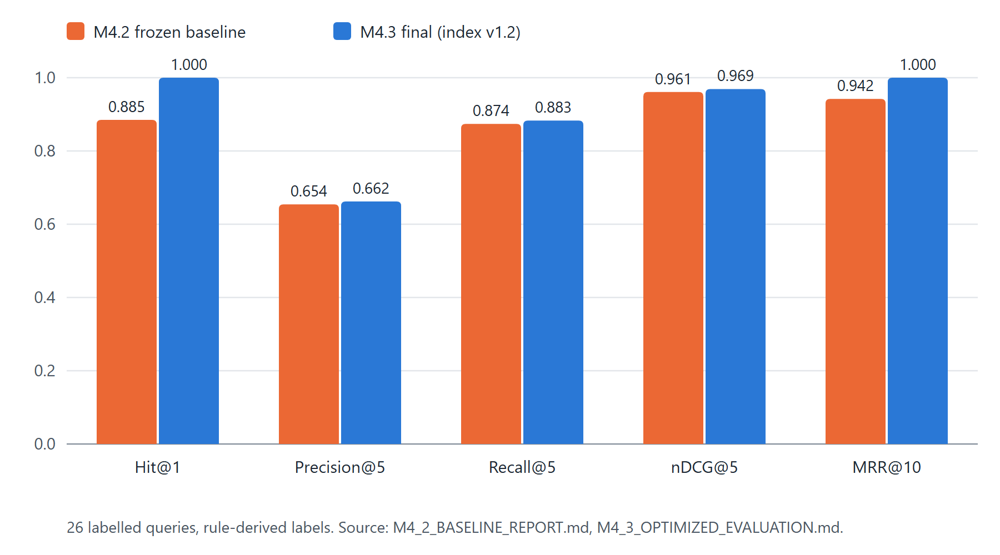

## Optimisation Experiments and Performance Measurements

Milestone 4.3 tested each change in isolation against the frozen M4.2 baseline and accepted or rejected it on the measured result. Table 7.6 summarises the decisions; the full log is `backend/data/evaluation/m4/results/m4_3_experiments.json`.

Table 7.6: Summary of M4.3 controlled experiments

| ID | Change | Outcome | Decision |
|---|---|---|---|
| E1 | Discovery retrieves the requested area, scores against the resume | Expected-domain hit 0.0 → 1.0 | Accept |
| E2a | Deterministic intent rules for comparison, learning-priority and discovery wording | Conversation turns 12/16 → 15/16 | Accept |
| E2b | General-question handling | Not implementable offline without overfitting | Reject / deferred |
| E3a–E3c | Related-skill credit for required skills; gating; weight changes | Ordering inversions or M2 regressions | Reject |
| E3e | Related credit for preferred skills only; `node.js` normalisation fix | C > D now holds; margins still below target | Accept |
| E4 | Shared education assessment | Matching ↔ skill-gap disagreements 2 → 0 | Accept |
| E5 | Allow job title and company in validator | Review items 1 → 0; faults 10/10 | Accept |
| E6 | Query-term coverage flag (variant C) | 11/12 off-topic, 0/26 genuine flagged | Accept as flag only |
| E7 | Profile-only skills shown as self-reported | Review items 3 → 0 | Accept |
| E8-V1, V2 | Extra title chunk; prefix on all chunks | Precision/recall or integration regressions | Reject |
| E8-V3 | Title/type prefix on overview chunk; index v1.2 | Hit@1 1.0, MRR 1.0, nDCG@5 0.969 | Accept |
| E9 | Load embedding model from local cache first | Cold load 12.1–12.3 s → 7.3 s | Accept |
| E10 | In-process caches for dataset and index | e.g. `search_jobs` 46.71 → 9.44 ms | Accept |

Table 7.7: Performance before and after M4.3 (medians of repeated warm calls on the single development machine; deterministic pipeline; no LLM)

| Stage | Before M4.3 | After M4.3 |
|---|---:|---:|
| Dataset load and validation | 17.87 ms | 0.24 ms |
| Vector-store load | 4.94 ms | 0.14 ms |
| Query embedding | 7.67 ms | 5.27 ms |
| FAISS search (960 vectors) | 0.39 ms | 0.09 ms |
| `search_jobs` total | 46.71 ms | 9.44 ms |
| `match_jobs_for_resume` (top 10) | 78.05 ms | 16.31 ms |
| Skill-gap analysis | 27.61 ms | 3.07 ms |
| Customization (deterministic) | 20.04 ms | 4.57 ms |
| Cold embedding-model load (network allowed) | 12.1–12.3 s | 7.3 s |

These timings come from `M4_3_OPTIMIZATION_REPORT.md`. They were measured on one development machine and are not production latency guarantees. The large reductions in dataset, index, search, matching, skill-gap and customization times come from caching (E10), which removes repeated file loading and validation; embedding and FAISS code were unchanged, so their small differences are run-to-run variation. LLM latency and token usage were not measured.

## Grounding and Failure-Handling Evidence

Table 7.8: Grounding, consistency, conversation and discovery results

| Measure | M4.2 baseline | M4.3 final |
|---|---:|---:|
| Grounding violations (structured checks) | 0 (921 checks) | 0 (926 checks) |
| Needs-review items | 4 | 0 |
| Fault injections detected by the evaluator | 9/9 | 10/10 |
| Matching ↔ skill-gap consistency findings | 2 | 0 |
| Service hand-off chain (same resume and job through every service) | all hold | all hold |
| Conversation turns / full conversations with desired behaviour | 12/16 / 5/7 | 15/16 / 6/7 |
| Job discovery: requested area retrieved | 0/3 | 3/3 |
| Off-topic queries flagged / genuine queries flagged | 0/12 / 0/26 | 11/12 / 0/26 |
| Matching scenarios A / B / C / D | 54.8 / 52.0 / 21.1 / 21.1 | 56.5 / 52.0 / 26.1 / 21.1 |

Failure handling of the LLM layer is evidenced by fake-provider unit tests (for example TC-10 and TC-11): timeouts, malformed JSON, unknown evidence IDs, fabricated metrics and leadership claims, and unsupported technologies all fall back to the deterministic result.

**Re-run on 2026-10-16.** The evaluation was re-run on the current checkout into a scratch directory, leaving the tracked results unchanged. All retrieval, off-topic, matching, consistency, hand-off, conversation and discovery values were identical to Tables 7.5 and 7.8, and grounding violations remained 0. Three values differed from the tracked M4.3 file: 892 instead of 926 grounding checks were run; one needs-review item appeared (the validator removed one generated cover-letter sentence for one pair); and the per-pair `validation_passed` flags were false. The flags are explained by the stricter rules added in the resume-parsing audit: the evaluation's synthetic candidates carry no `parser_version`, so the services attach the outdated-parser notice, which by design prevents a "passed" status. The tracked M4.3 values therefore describe the code at the M4.3/M4.4 milestone, and the evaluation fixtures need a `parser_version` before they fully reflect the current code. This is recorded here as an open item rather than resolved by changing the fixtures.

## Results Summary

Table 7.9: Summary of verified results

| Item | Result | Evidence |
|---|---|---|
| Backend tests (M4.4 release audit) | 464 passed, 0 failed, 1 xfailed, 2 warnings | Final technical documentation, §21 |
| Backend tests (current checkout) | 555 passed, 0 failed, 1 xfailed, 2 warnings | Re-run, 2026-10-16 |
| Retrieval Hit@1 / @3 / @5 | 1.000 / 1.000 / 1.000 | `M4_3_OPTIMIZED_EVALUATION.md` |
| MRR@10 | 1.000 | same |
| Precision@5 / Recall@5 / nDCG@5 | 0.662 / 0.883 / 0.969 | same |
| Grounding violations | 0 | same; re-run 2026-10-16 |
| Fault injections detected | 10/10 | same |
| Conversation turns | 15/16 | same |
| Discovery probes | 3/3 | same |
| Dataset | 320 records, 15 domains, 0 duplicates; SHA-1 `d9401f90…` | `validation_report.json`; hash re-checked 2026-10-16 |
| Index | `IndexFlatIP`, 960 vectors, 384 dimensions, version 1.2 | index metadata, re-checked 2026-10-16 |

## Test Success Versus Real-World Effectiveness

Passing tests show that the implementation behaves as specified on the cases that were written; the evaluation shows how the pipeline performs on a small set of synthetic, rule-labelled fixtures. Neither shows that recommendations are useful to real students, that generated documents improve application outcomes, or that the system generalises to resumes and opportunities unlike those in the fixtures. No user study, A/B test or field trial was conducted.

## Limitations of the Evaluation

- **Small, synthetic data.** 26 labelled queries, 12 off-topic queries, 5 synthetic candidates (8 pairs) and 16 conversation turns. The labels are rule-derived, not human judgements.
- **Catalogue structure.** Postings within a domain share identical skill lists, so job-level relevance is distinguished only by title and type; this makes some retrieval metrics easier to saturate.
- **General career questions (CV06)** still fail in deterministic mode.
- **Matching margins.** The required-strong versus preferred-strong margin (A − B = 4.5) and the semantic versus unsuitable margin (C − D = 5.0) remain below the target of 10 points.
- **Confidence heuristic.** One off-topic query ("UI UX design internship with Figma") is not flagged because its words exist in the catalogue, and on a held-out check one genuine query ("Linux system administration trainee") was flagged.
- **No live-LLM evaluation.** LLM output quality, latency, cost and token usage were not evaluated; a single manual spot check on one synthetic resume is not an evaluation.
- **Frontend testing on the canonical baseline** was manual (type check, lint, build and a 13-step browser walkthrough).

## Work Beyond the Canonical Baseline

The checkout used to prepare this report is a feature branch (`feature/ui-redesign-skill-graph`) that is not yet merged into `develop`. It adds a UI redesign, stronger enforcement of test isolation (8 additional backend tests that prove the test suite cannot open the real database or resume store or reach the network) and a Playwright browser-test suite. Its backend application code is identical to `develop`. Because this work is outside the finalised baseline, it is not described or evaluated further in this report, and the Playwright suite was not run for it.

# Results and Discussion

## What the System Demonstrates

The implemented system demonstrates that a complete student career workflow — resume parsing, opportunity retrieval, explainable matching, gap analysis, grounded document tailoring, interview preparation, conversational access and application tracking — can be built on a deterministic core that works without any language model. Every number shown to the user is computed by explicit code from persisted data, every generated sentence is checked against evidence, and every user's data is isolated.

## Fulfilment of the Objectives

Table 8.1: Objectives and how they were addressed

| Objective | Status | Evidence |
|---|---|---|
| 1. Structured context without OCR or LLM | Met, with documented parsing limitations | Resume pipeline; parser tests; manual walkthrough |
| 2. Semantic retrieval from a validated knowledge base | Met | Retrieval metrics (Table 7.5) |
| 3. Transparent, deterministic scoring | Met; margins below target | Matching tests; scenarios A–D |
| 4. Traceable generation without unsupported claims | Met on the evaluation fixtures | 0 grounding violations; validator tests |
| 5. Subordinate LLM with fallback | Implemented; live quality not evaluated | Fake-provider tests |
| 6. Per-user ownership | Met | API isolation tests; end-to-end second-user probes |
| 7. Measured improvement and honest reporting | Met | Frozen baseline, experiment log, this chapter |

## Interpretation of Retrieval and Performance Results

The retrieval results show that, on the evaluation queries, the first-ranked opportunity was always relevant (Hit@1 = 1.000, MRR@10 = 1.000), and the ranking of relevant and acceptable jobs was close to ideal (nDCG@5 = 0.969). Precision@5 of 0.662 means that, on average, about two-thirds of the top five results are labelled *relevant*; most of the remainder are labelled *acceptable* rather than wrong, which the graded nDCG reflects. The improvement from the baseline came mainly from experiment E8-V3, which helped the model distinguish postings by title and type within a domain. Because the catalogue is small and labels are rule-based, these values should be read as evidence that the pipeline is correctly assembled and tuned for its fixtures, not as an estimate of performance on real job markets.

The performance results show that once the dataset and index are cached, deterministic operations complete in milliseconds on the development machine, and that loading the embedding model from the local cache roughly halves cold-start time. These figures support the responsiveness requirement (NFR-08) for a single-user local setting; no load or concurrency testing was performed.

## Practical Benefits and Usability Observations

The M4.4 manual walkthrough (13 steps on a fresh database with a synthetic resume) confirmed that empty states are truthful on a new account, that extracted data drives the dashboard, that off-topic searches show a notice while still listing results, that skill-gap and customization outputs pass the grounding check, that tracker data and reminders persist across reloads, and that the Learning Roadmap page states that the feature is unavailable. These are observations by the developer, not measurements of usability or user satisfaction.

## Trade-offs of the Deterministic-plus-Optional-LLM Design

The deterministic core gives reproducibility, explainability, offline operation, zero API cost and strong protection against fabricated claims, and it makes the system testable with exact assertions. The cost is flexibility: wording is template-based, unusual phrasings may be misrouted by rule-based intent classification, and open-ended career questions cannot be answered in deterministic mode. The optional LLM layer is designed to recover fluency without giving up grounding, but it adds latency, external dependency and cost, and its benefit has not been measured. Retrieval-augmented generation [6] and the risk of unfaithful generation in language models [7] motivate the decision to let the model rewrite only validated content.

## Threats to Validity and Generalisability

- **Construct validity.** Rule-derived labels approximate relevance; a human judge might rate some "acceptable" jobs as relevant, or the reverse.
- **Internal validity.** Experiments were evaluated on the same fixtures that revealed the weaknesses, so some tuning to the fixtures is possible despite the use of held-out checks for E6 and E8-V3.
- **External validity.** The catalogue covers 15 technology domains with synthetic postings; results do not transfer to other fields, to live postings or to resumes with unusual layouts.
- **Measurement.** Timings come from one machine and are medians of warm calls; they vary with hardware and load.
- **Evaluation currency.** As noted in Section 7.8, the tracked evaluation predates the parser-version rules added later, and a re-run differs in three grounding-related values.

# Security, Privacy and Reliability

## Password Hashing

Passwords are hashed with `PasswordHash.recommended()` from `pwdlib`, which produces Argon2id hashes (stored values begin with `$argon2id$`) [8]. Plain-text passwords are never stored or logged. Verification uses the same library.

## Session-Token Generation and Storage

A session token is generated with `secrets.token_urlsafe(48)` (48 random bytes). Only its SHA-256 digest [9] is stored in `auth_sessions.token_hash`, so a database leak does not reveal usable tokens. Sessions expire after 14 days and are deleted on logout. The token is sent as the `ai_career_session` cookie [10] with `HttpOnly` (not readable by scripts), `SameSite=Lax` and a 14-day `Max-Age`; the `Secure` attribute is set automatically whenever `APP_ENV` is not `development` and can be overridden with `SESSION_COOKIE_SECURE`. In local development over plain HTTP the cookie is not `Secure`.

## Authentication, Authorisation and API Access Control

Every user-data router (profiles, resumes, candidate context, skill gap, customization, interview preparation, assistant and applications) depends on `require_current_user`. Unauthenticated requests receive 401. Queries are filtered by the current user, and objects belonging to another user return 404, not 403, so their existence is not disclosed. `/health` and the read-only opportunity catalogue (`/api/jobs/*`) are public by design. CORS allows the configured `FRONTEND_URL` exactly, with credentials, and allows any `localhost`/`127.0.0.1` port only when `APP_ENV=development`.

## User-Data Ownership and Cross-User Isolation

Ownership is enforced in two places: helper functions that load a profile or resume only if it belongs to the caller, and service-level filters on `user_id`. Linked tracker artifacts must belong to the same user and job. Isolation is covered by API tests in each feature area and by the end-to-end workflow test, in which a second user is denied access to every object created by the first. In the M4.4 manual check, a second user received 404 for the first user's application (GET, PATCH and DELETE), resume, structured resume, profile, candidate context, customizations, skill gap and conversation.

## Input and File Validation

All request bodies and parameters are validated by Pydantic schemas. Uploaded files are checked by extension, size (≤ 10 MiB), emptiness and content signature or structure, stored under generated names outside any served path, and never returned by internal path. Generated text is validated for grounding before it is stored or displayed.

## Error Handling and Fallback Behaviour

Unhandled exceptions are logged and returned as a generic `{"detail": "Internal server error"}` with CORS headers, so internals are not exposed and the browser can show a readable message. LLM failures always fall back to deterministic results. The client turns 401 responses into a return to the sign-in page and replaces 5xx details with a generic message.

## Data Handling and Privacy Assumptions

Resumes, the database and `.env` files are stored locally and excluded from version control. No browser storage holds account data. When an LLM provider is configured, grounded excerpts of the candidate's evidence are sent to that provider; the user's operator is responsible for choosing a provider whose data-handling terms are acceptable. The LLM API key is read from the environment only, and startup logs record only whether a key is present. Test data is synthetic, and the test suites are prevented from reading the real database or resume store.

## Remaining Security Limitations

The following are **not** implemented: OAuth or single sign-on, CSRF tokens (mitigated only by `SameSite=Lax`), rate limiting and login throttling, account lockout, e-mail verification, password reset, encryption at rest, HTTPS configuration (the project runs over local HTTP), audit logging, and penetration testing. No formal security audit was performed, and no regulatory compliance is claimed. The single-process caches assume one server process.

# Limitations and Future Enhancements

## Current Limitations

1. **General career questions (CV06).** Free-form questions such as salary negotiation receive a fixed capability message in deterministic mode; the strict `xfail` remains.
2. **Matching margins below target.** A − B = 4.5 and C − D = 5.0 against a target of at least 10; variants that widened the margins caused ordering inversions or regressions and were rejected.
3. **Heuristic confidence flag.** 11/12 off-topic and 0/26 genuine evaluation queries are flagged, but one held-out genuine query was flagged and one off-topic query is missed. It is a notice only.
4. **Limited evaluation coverage.** Small, synthetic, rule-labelled fixtures; results are not statistically representative.
5. **No comprehensive live-LLM evaluation.** Quality, latency, cost and token usage of the LLM path were not evaluated.
6. **Learning Roadmap not implemented.** The page states that roadmap generation is unavailable; legacy roadmap tables exist without an active feature.
7. **No database migration framework.** Tables are created with `create_all`, plus one ad-hoc column helper; there is no Alembic.
8. **Curated catalogue.** 320 project-authored postings in 15 technology domains; no live feeds, application links or deadlines.
9. **Rule-based resume parsing.** No OCR; unusual layouts may extract imperfectly; experience is one entry per section.
10. **Local security scope.** See Section 9.8.
11. **Single-process design.** Caches and SQLite assume one process; the system is not deployed.
12. **Evaluation fixtures predate parser versioning.** The tracked evaluation results differ from a re-run on current code in three grounding-related values (Section 7.8).

## Future Enhancements

The following items are proposals. None of them is implemented.

- **Larger, more diverse and independently evaluated data:** a bigger catalogue across more career domains and human-judged retrieval and matching benchmarks.
- **Better-calibrated ranking and confidence:** revisit matching margins with more scenarios and replace the coverage heuristic with a trained or calibrated out-of-coverage detector.
- **Live-LLM evaluation:** a fixed, reviewed prompt set measuring grounding violations, quality, latency and token usage, and a resolution of CV06.
- **Learning Roadmap:** roadmap generation from skill gaps, with progress tracking.
- **Deployment hardening:** HTTPS with Secure cookies, CSRF protection, rate limiting, password reset, Alembic migrations, structured logging and monitoring, containerisation and continuous integration.
- **Data and parsing:** real job-feed integration with deadlines and application links, OCR for scanned resumes and per-role experience extraction.
- **Accessibility, usability and broader user testing,** including a study with real students under appropriate consent.
- **Evaluation maintenance:** add `parser_version` to the synthetic evaluation candidates and regenerate the tracked results.

# Conclusion

Students entering the job market need to know which opportunities fit them, what they are missing, and how to present their real experience — and general-purpose generators can answer these questions fluently but without grounding. This project set out to build a system that answers them from the student's own evidence.

AI Career Companion implements that system as a React and FastAPI web application with a deterministic core. A resume is parsed into a structured candidate context; sentence embeddings and an exact FAISS index retrieve related opportunities from a curated 320-record catalogue; a weighted, explainable scorer ranks them; a requirement-level skill-gap analysis, grounded resume and cover-letter customization, interview preparation, a conversational assistant and an application tracker build on the same context; and an optional LLM can only rewrite validated content, with a deterministic fallback.

The key engineering contributions are the separation of semantic selection from deterministic reasoning, a sentence-level grounding validator, a shared reliability rule for parsed evidence, strict per-user ownership, and an evaluation methodology based on a frozen baseline and controlled, individually measured experiments, with rejected experiments recorded alongside accepted ones. On its evaluation fixtures the final system reached Hit@1 and MRR@10 of 1.000, nDCG@5 of 0.969, zero grounding violations, 10/10 detected fault injections, 15/16 correct conversation turns and 3/3 discovery probes, and the backend test suite passed with only the known CV06 expected failure.

The practical significance is a demonstration that useful, explainable career assistance can be delivered without depending on a language model, and that generation can be made safe by validating it against evidence. The evidence is, however, limited to small synthetic fixtures. Realistic next steps are a larger human-judged benchmark, a live-LLM evaluation, better-calibrated ranking and confidence, an implemented learning roadmap, migrations and deployment hardening, and a properly designed study with real users.

# References {.unnumbered}

<!-- references -->

[1] N. Reimers and I. Gurevych, "Sentence-BERT: Sentence embeddings using Siamese BERT-networks," in *Proc. 2019 Conf. Empirical Methods in Natural Language Processing and 9th Int. Joint Conf. Natural Language Processing (EMNLP-IJCNLP)*, Hong Kong, China, 2019, pp. 3982–3992, doi: 10.18653/v1/D19-1410.

[2] J. Johnson, M. Douze, and H. Jégou, "Billion-scale similarity search with GPUs," *IEEE Trans. Big Data*, vol. 7, no. 3, pp. 535–547, Jul. 2021.

[3] W. Wang, F. Wei, L. Dong, H. Bao, N. Yang, and M. Zhou, "MiniLM: Deep self-attention distillation for task-agnostic compression of pre-trained transformers," in *Advances in Neural Information Processing Systems 33 (NeurIPS 2020)*, 2020.

[4] K. Järvelin and J. Kekäläinen, "Cumulated gain-based evaluation of IR techniques," *ACM Trans. Inf. Syst.*, vol. 20, no. 4, pp. 422–446, Oct. 2002, doi: 10.1145/582415.582418.

[5] C. D. Manning, P. Raghavan, and H. Schütze, *Introduction to Information Retrieval*. Cambridge, U.K.: Cambridge Univ. Press, 2008.

[6] P. Lewis *et al.*, "Retrieval-augmented generation for knowledge-intensive NLP tasks," in *Advances in Neural Information Processing Systems 33 (NeurIPS 2020)*, 2020, pp. 9459–9474.

[7] Z. Ji *et al.*, "Survey of hallucination in natural language generation," arXiv:2202.03629, 2022.

[8] A. Biryukov, D. Dinu, D. Khovratovich, and S. Josefsson, "Argon2 memory-hard function for password hashing and proof-of-work applications," IETF, RFC 9106, Sep. 2021.

[9] National Institute of Standards and Technology, "Secure Hash Standard (SHS)," FIPS PUB 180-4, Aug. 2015.

[10] A. Barth, "HTTP state management mechanism," IETF, RFC 6265, Apr. 2011.

[11] FastAPI documentation. [Online]. Available: https://fastapi.tiangolo.com/

[12] SQLAlchemy 2.0 documentation. [Online]. Available: https://docs.sqlalchemy.org/

[13] React documentation. [Online]. Available: https://react.dev/

[14] Sentence-Transformers documentation. [Online]. Available: https://www.sbert.net/

[15] "sentence-transformers/all-MiniLM-L6-v2," model card, Hugging Face. [Online]. Available: https://huggingface.co/sentence-transformers/all-MiniLM-L6-v2

[16] FAISS library repository and documentation. [Online]. Available: https://github.com/facebookresearch/faiss

[17] Pydantic documentation. [Online]. Available: https://docs.pydantic.dev/

[18] pypdf documentation. [Online]. Available: https://pypdf.readthedocs.io/

[19] python-docx documentation. [Online]. Available: https://python-docx.readthedocs.io/

[20] J. Jarald, "AI Career Companion — Final Technical Documentation (Milestone 4.4)," project document `docs/FINAL_TECHNICAL_DOCUMENTATION.md`, AI Career Companion repository, Oct. 2026.

# Appendix A: API Endpoint Summary {.appendix}

All paths are relative to the API base URL. "Session" means a valid session cookie is required; another user's resources return 404. The schema is served at `/openapi.json` and interactive documentation at `/docs`.

Table A.1: API operations (47)

| Group | Operations | Access |
|---|---|---|
| Health | `GET /health` | Public |
| Auth | `POST /api/auth/register`, `POST /api/auth/login`, `GET /api/auth/me`, `POST /api/auth/logout` | Public / session |
| Profile | `POST /api/profiles`, `GET /api/profiles/{profile_id}`, `PATCH /api/profiles/{profile_id}` | Session |
| Resume | `POST`/`GET /api/profiles/{profile_id}/resumes`, `GET /api/resumes/{resume_id}`, `POST …/extract-text`, `GET …/extraction`, `POST …/detect-sections`, `GET …/sections`, `POST …/structure`, `GET …/structured` | Session |
| Candidate context | `POST`/`GET /api/profiles/{profile_id}/candidate-context?resume_id=` | Session |
| Jobs | `GET /api/jobs/search?q=&top_k=` (1–20), `GET /api/jobs/{job_id}` | Public, read-only |
| Matching | `GET /api/resumes/{resume_id}/job-matches?top_k=` | Session |
| Skill gap | `POST /api/resumes/{resume_id}/skill-gap`, `GET …/skill-gap/{job_id}` | Session |
| Customization | `POST`/`GET …/application-customizations`, `GET`/`PATCH …/{customization_id}`, `POST …/{customization_id}/regenerate`, `GET …/{customization_id}/export?format=pdf\|docx` | Session |
| Interview prep | `POST`/`GET …/interview-preparations`, `GET …/{prep_id}`, `POST …/{prep_id}/regenerate`, `POST …/{prep_id}/mock-answer` | Session |
| Assistant | `POST`/`GET /api/career-assistant/conversations`, `GET`/`DELETE …/{conversation_id}`, `POST …/{conversation_id}/messages` | Session |
| Applications | `POST`/`GET /api/applications`, `GET /api/applications/summary`, `GET /api/applications/reminders?days=` (1–60), `GET`/`PATCH`/`DELETE /api/applications/{application_id}` | Session |

# Appendix B: Dataset Provenance and Evaluation Fixtures {.appendix}

Table B.1: Opportunity dataset

| Property | Value |
|---|---|
| File | `backend/data/internships/career_opportunities_320.json` (CSV mirror and JSON Schema alongside) |
| Origin | Curated, project-authored synthetic records for academic development and evaluation; company names are not real employers; not live vacancies |
| History | 180 internship records (Milestone 2.1), expanded with 140 records in the career-opportunity generalisation |
| Records / domains | 320 / 15, with 21–22 records per domain |
| Domains | Cloud Computing, Cybersecurity, Data Analytics, Data Science, Database / SQL, DevOps, Frontend Development, Full Stack Development, Generative AI / NLP, Java Backend, Machine Learning, Mobile Development, Python Backend, Software Development, Software Testing / QA |
| Opportunity types | Internship 170, Entry Level 80, Graduate Role 45, Trainee 15, Apprenticeship 10 |
| Validation | 0 missing required values, 0 duplicate IDs, 0 duplicate content (PASS) |
| Integrity | SHA-1 `d9401f9085e7edd9ee9dd8725f344e38ef07aa30` (re-checked 2026-10-16) |

Table B.2: Evaluation fixture sizes (`backend/data/evaluation/m4/cases`)

| Section | Size |
|---|---|
| Positive retrieval queries | 26 (136 relevant + 612 acceptable job labels, rule-derived) |
| Negative / off-topic queries | 12 (unrelated, nonsense, out-of-coverage) |
| Synthetic candidates / candidate–job pairs | 5 / 8 |
| Matching scenarios | 4 (required-strong, preferred-strong, semantic-not-exact, unsuitable) |
| Conversations / turns | 7 / 16 |
| Job-discovery probes | 3 |

# Appendix C: Selected Configuration and Reproduction Commands {.appendix}

The following commands reproduce the verification steps on Windows PowerShell from the repository root. They do not modify tracked evaluation results when `--output-dir` points to a scratch folder.

```text
cd backend
..\.venv\Scripts\python.exe -m pytest -q
..\.venv\Scripts\python.exe scripts\validate_job_dataset.py
..\.venv\Scripts\python.exe scripts\run_m4_evaluation.py `
    --output-dir $env:TEMP\m4_eval
cd ..
npx tsc -b
npm run lint
npm run build
```

Running the application requires the FAISS index, which is not committed and is built once with `scripts\build_job_vector_index.py`; the backend is started with `..\.venv\Scripts\python.exe -m uvicorn app.main:app --reload` from `backend`, and the frontend with `npm run dev`.

# Appendix D: Glossary {.appendix}

Table D.1: Glossary

| Term | Meaning in this report |
|---|---|
| Candidate context | The combined career profile and structured resume used as input by all services |
| Chunk | One of three text segments (overview, requirements, responsibilities) of an opportunity, embedded separately |
| Deterministic fallback | The rule-based result returned when no LLM is configured or the LLM output fails validation |
| Evidence ID | An identifier attached to a piece of candidate evidence and cited by generated content |
| Grounding | The property that every generated claim is supported by the candidate's evidence or the job record |
| Match score | Weighted 0–100 score of fit between a candidate and an opportunity |
| Readiness | Separate weighted 0–100 score from the skill-gap analysis |
| Self-reported skill | A skill listed only in the profile and not demonstrated in the resume |
| Strict xfail | A test marked as an expected failure that fails the suite if it unexpectedly passes |
| `unsupported_area` | Query-confidence label for a search whose words are mostly absent from the catalogue |
